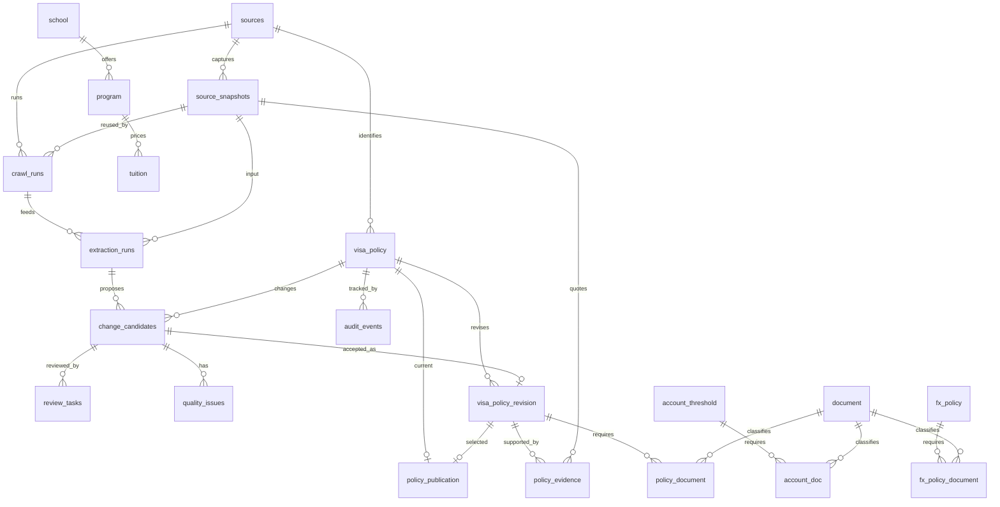

# Agent1 正式数据库：环境与结构

状态：2026-10-13，已编写环境隔离、DDL、初始化器及增量扫描到候选的开发入口。
本次只在系统临时目录执行离线测试；实际开发/正式库未初始化，不迁移/删除旧数据，
未运行真实抓取或模型调用。正式发布、审核决定与旧库迁移尚未接入。

## 1. 旧测试数据为什么会出现

旧版 `config.py` 把所有入口都指向 `data/agent1.sqlite3`。
`db.session()` 每次连接都会创建旧表；E2E 验证也在同一个文件里运行。
`EVALUATION.md` 的补记五记录过将调试期 v1～v7 清成 v1，但旧运行与审计仍引用原编号/ID。
因此数据库文件完整性正常，不代表业务引用完整。新代码不尝试猜测或修复那些缺失记录。

## 2. 环境边界

```text
data/
  agent1.sqlite3                 旧混合库，保留原位；新入口不连接
  snapshots/                    旧快照，保留原位
  gate/                         旧问题清单，保留原位
  development/
    agent1.sqlite3              开发环境的新结构库
    snapshots/                 新结构快照
    legacy/                    旧管道的开发兼容区
      agent1.sqlite3
      snapshots/
      gate/problems.json
  production/
    agent1.sqlite3              正式环境的新结构库
    snapshots/
  archive/                      预留；第五步再制定归档及迁移操作

系统临时目录/globalpathway-agent1-test-<随机值>/
  agent1.sqlite3                测试环境的新结构库
  snapshots/
  legacy/                      测试兼容区
```

上图为路径约定，目录/数据库只在显式使用时创建，本次未创建新库。

- 默认 development；`--env` 覆盖 `AGENT1_ENV`。未知值直接报错，不回落到正式环境。
- test 的路径由程序分配，不接受任意数据库路径覆盖；正常退出自动删除进程自己的临时目录。
  进程强杀可能留下临时目录，但不会进入正式目录。测试模式不会清理 development/production。
- `触发测试.bat` 显式覆盖环境为 development，调试结果可保留且不进入正式库。
- 环境路径禁止符号链接/junction 重定向；每个新库有自身环境标记，复制测试库到正式目录后也不能直接使用。
- 公共 `sources.json` 是来源登记模板，不是发布状态；各环境来源登记内容分别落库。
- API key 仍通过已有配置读取，数据库不保存密钥。业务/测试代码不能自行指定正式库路径作为测试文件。
- 环境选择是本地配置边界，并非多租户授权体系；运行账号的文件权限仍需按部署方式配置。

### 兼容期的入口

新 `db init/status` 使用新库；原 `sources/run/review/knowledge/...` 使用独立 legacy 库，
只允许 development/test。production 暂时只接受 `db init/status`，避免旧发布逻辑写进正式环境。
这是分阶段接入，不是已经完成新版 Agent1 的生产切换。
开发兼容库开始为空，来源需显式同步；不会从旧混合库复制已发布知识或测试记录。

## 3. 表结构及数据归属

可执行字段定义以 `agent1/migrations/001_formal_schema.sql` 和 `002_other_business_tables.sql` 为准。
数据库时间统一为 UTC ISO 8601；ID 不携带版本号且不得重新编号。
内容文件使用相对于当前环境 snapshots 目录的路径；后续采集服务必须验证路径不越界。

### A. 采集、抽取和候选

| 表 | 主键/主要内容 | 关系与用途 |
| --- | --- | --- |
| sources | source_id、URL、国家、负责人、审核状态、周期、SLA、采集配置 | 默认 pending/停用；新来源不会隐式批准 |
| source_snapshots | snapshot_id、内容哈希、采集配置哈希、文件路径 | 按来源+内容+配置去重，不同来源不会错误合并快照 |
| crawl_runs | run_id、source_id、snapshot_id、状态、retry_of、错误 | 一次抓取一条记录；同来源最多一个 RUNNING；无变化可引用已有快照 |
| extraction_runs | extraction_id、run/snapshot、模型、提示词/Schema/提取器版本、原始结果、token | 一次模型/规则处理一条记录，与抓取次数分开 |
| change_candidates | candidate_id、extraction_id、基线修订、完整新内容、差异、证据、门控结论 | 审核的是候选内容；保留规则归一化版本，不直接覆盖正式修订 |
| review_tasks | review_id、candidate_id、理由、状态、处理人/时间/备注 | 一个候选最多一条 OPEN 任务，决定后保留历史 |
| quality_issues | issue_id、run/extraction/candidate、字段、严重度、解决依据 | 新结构替代 problems.json；关闭必须记录处理人、时间和依据 |
| source_check_state / source_check_events | HTTP 校验值、原始响应哈希、下次检查、每次检查结果 | 到期检查，304 或正文未变时跳过浏览器与模型 |
| snapshot_sections / section_extractions | 章节定位与哈希、抽取配置指纹、缓存结果 | 正文变化时复用未变章节的抽取；提示词/Schema/模型变更使缓存失效 |
| source_section_dependencies | 章节依赖 | 可显式声明联动；资格/豁免章节变化时保守地重新处理全页 |

`input_manifest_json` 记录实际输入的段落/字符区间和分块信息；`coverage_status` 区分完整、部分、未知。
新增量入口会覆盖全部章节，大章节重叠切分，不再只送前 2500 字符。
当正文结构或适用条件无法安全合并时运行失败、保留正式知识；不会发布不完整结果。
候选的 `policy_id` 对签证类型必填；其他领域允许先保存独立候选，不伪装成签证政策。

### B. 正式知识

| 表 | 主键/主要内容 | 关系与用途 |
| --- | --- | --- |
| visa_policy | policy_id、source_id、country、policy_type、policy_topic、scope_code | 稳定政策身份；scope_code 如 london/outside_london，不使用模型自由措辞作为主键 |
| visa_policy_revision | revision_id、policy_id、revision_no、candidate_id、结构化业务字段 | 一次正式采纳的内容修订；不可更新/删除；每政策编号唯一 |
| document | doc_id、稳定 code、中文名称、别名 | 统一材料名称；别名可归一化，不能凭模型生成新 code 就认定新增材料 |
| policy_document | revision_id、doc_id、requirement_key、required、适用条件 | 材料要求属于具体修订；同材料可有多条不同条件的要求 |
| policy_evidence | evidence_id、revision_id、snapshot_id、字段/材料定位、逐字引用 | 证据必须属于同来源；材料证据必须能关联到具体要求 |

资金、CAS、I-20、英语、体检、费用、日期等字段沿用原 ER 图，内容字段放到 revision。
其中 `funds_tuition_unpaid` 仍是金额；新增 `funds_tuition_required` 表示是否要求准备学费。
未知金额保持 NULL，不能将 true 转换为金额 1。模型层和旧数据转换的修改留到后续接入阶段。
金额非负，有金额必须有对应币种；SQLite NUMERIC 不能作为任意精度金融计算的保证，
后续计算使用 Decimal，并在迁移至 PostgreSQL 时确定 NUMERIC 精度，不用二进制浮点算账。

`conditions_json` 承载政策资格、豁免和限制，建议每条包含稳定 code、作用字段及结构化条件。
remark 只承载说明；如何从说明拆条件是后续抽取与门控服务的责任。

材料条件三态：

- unconditional：原文明示无附加条件，condition_json 为 NULL。
- conditional：必须存非空的条件对象，不能只存 required=true。
- unknown：条件尚不明确，required 必须为 NULL，避免当成无条件必需。

结构约束不能自动理解原文的 If/unless。条件是否提取完整、引用是否真正支持取值，仍需后续门控。

原外部知识库中的其他领域单独建表，保留原业务字段，增加来源和创建时间：

| 表 | 关系/补充约定 |
| --- | --- |
| fx_policy / fx_policy_document | 汇款规则及材料；与签证材料关系拆开，以便数据库可以落实真实外键 |
| account_threshold / account_doc | 开户门槛及材料 |
| credit_card | 信用卡；年费增加币种，返现/加价率用 0～1 比例（0.02 表示 2%） |
| school / program / tuition | 学校 → 课程 → 学年学费；各自可来自不同登记页面 |

这些表只完成字段和关系定义，当前没有导入或对外发布入口。它们的专用修订/证据/发布服务
后续独立扩展；不会通过签证 publication 指针发布，也不把通用事实直接当作已核验业务记录。

### C. 发布、审计与结构升级

| 表 | 主键/主要内容 | 关系与用途 |
| --- | --- | --- |
| policy_publication | policy_id、revision_id、ACTIVE/WITHDRAWN、发布人、最近核验、撤回信息 | 每政策一个当前指针；必须引用该政策自己的修订和来源自己的核验运行 |
| audit_events | event_id、transaction_id、候选/审核/政策引用、前后 revision、操作者、理由 | 追加式记录，禁止更新/删除；同次多范围发布用相同 transaction_id |
| schema_migrations | version、checksum、applied_at | 显式、事务式应用 DDL；已执行文件变更或未知迁移版本会报错 |
| database_identity | 固定一行：environment、schema_family、创建时间 | 校验库身份，拒绝旧库直接初始化或跨环境误用 |

不再同时维护 knowledge_versions.status、knowledge_index.availability 和 published_knowledge
三套发布状态；新结构由 publication 指针表达当前发布状态。
当前实现见下文「发布面」：签证政策用 `POLICY_REVISION` / `POLICY_PUBLICATION` / `PUBLICATION_EVENT`。

### D. 增量检查与变化规则（开发入口已接入）

`scan` 仅允许 development/test，要求来源已明确 approved 且 enabled。
首次扫描或距离上次完整检查超过 7 天（可按来源配置）时全量浏览器抓取并重新抽取。
静态页的日常检查先读取 robots.txt，再用保存的 ETag/Last-Modified 做条件 GET；
304 和同一原始响应哈希可直接复用快照。动态页不使用这个静态页捷径，仍由 Crawl4AI 渲染。
当条件请求不可用时使用 Crawl4AI；即使 HTML 变化，Markdown 未变也不重新抽取。

变化后的 Markdown 按标题切分，长章节带重叠切分，记录所有输入章节。
章节缓存按来源、内容、模型/提示词/Schema、完整检查周期区分。
适用条件/豁免章节变化会扩大到全页，以免只更新金额却漏掉条件。
章节之间同一字段或材料条件冲突会失败并留下检查记录。
已发布内容与新结果的比较忽略 remark 措辞和材料顺序，保留条件变化；
字段/材料本次漏抽不会自动删除。疑似资格/豁免只留在 remark 时进入待解决候选。
所有候选都不自动发布；完整的变化进入审核，质量问题需解决后才能进入后续发布阶段。
当前没有后台定时服务接入新入口，须显式调用 `scan <来源>`、`scan-region <区域>` 或 `scan-fx <国家>`。

#### 按区域合并（当前 VISA_POLICY 实现）

一个目的地（`sources.json` 的 `region`：UK / US / CN-HK）的签证事实分散在多个官方页面
（概览、资金、英语、材料、费用……）。每个页面单独抓取、抽取，并只对照**自己的快照**过门控
（问题按 source_id 写入 GATE_ISSUE）；随后同区域所有页面的门控通过字段合并为一组
VISA_POLICY 行，`policy_id = uuid5("visa_policy:<country>:student:<scope>")`，
与来源无关，所以任何页面上的事实都落到同一行。

- scope 只表示目的地内的就读地差异（如 London / Outside London）；无差异时为 `all`。
  scope 写成目的地本身（UK、Hong Kong 等）视为通用规则。
- 页面内先逐章节核对证据：引用在快照中找不到、或数字不在引用中的章节取值直接丢弃
  （记 warning 级 GATE_ISSUE），不参与合并，因此模型编造的值既不会胜出，也不会把其他章节的
  有效取值拖成冲突。
- 字段级门控：有门控错误或跨页面取值冲突的字段不自动写入，带证据进入 REVIEW_QUEUE；
  跨页面冲突另记一条 `source_id = region:<区域>` 的 GATE_ISSUE。
- 新范围直接插入门控通过的字段；已有行中**空列**直接补齐，**已有值变化**进入审核（UPDATE）；
  remark 为自由文本，只在为空时补齐。
- 材料清单按 (code, name_zh) 合并；某页仅"提及"（required=false）而另一页"必须提供"时取必须。
  同一材料条件不同时：无条件要求覆盖有条件的；否则合并为 `{"any_of": [条件1, 条件2]}`，
  condition_quote 以 ` | ` 连接各自的逐字引用，门控逐条核对。
  未关联过的材料直接关联，已关联材料的必需性/条件变化进入审核。
  区域所有页面都读到、且没有任何章节（核对证据之前）再提到某个已关联材料时，移除提议进入同一条
  UPDATE 审核（`removed_documents`），批准后删除关联及其证据；只是引用没通过核对的材料仍算被提到，
  不提议移除。若该材料原有引用仍逐字在页面上（`still_quoted`），审核原因会单列，提示先核对是否漏抽。
  引用截掉了所在行方括号限定（如 “[if ...]”）的“必需”材料按条件未知处理；紧贴表格行的单个 `#`
  行视为表格脚注，不切成新章节。
  材料不随就读地变化，但每个 scope 行都关联完整材料清单：区域有多个 scope 时（如英国
  London / Outside London），同一 doc_id 会以相同 required/condition 出现在每个 policy_id 下，
  这是按政策行存放的预期冗余，不是重复数据。
- `doc_id = uuid5("document:<code>:<name_zh>")`（小写），由材料文字确定而不是每份真实文件一个编号：
  标准代码的 name_zh 由提示词固定，ID 稳定；`other_document` 的 name_zh 由模型给出，
  措辞不同会得到不同的 doc_id。
- 必须提供、无条件的 `cas` / `form_i20` 材料会推导出 `cas_required` / `i20_required`，
  证据为该材料的逐字引用，仍过门控。
- `scan <来源>` 只重新检查该页面，同区域其他页面沿用上次快照（不联网，命中缓存时不调用模型）。
- 材料适用条件三态：`required=1`（有/无条件）、`required=0`（仅提及）、`required=NULL`（原文带条件但未能确认）。
  原文带 if/unless 却没抽出条件、或条件引用在快照中找不到时，材料记为条件未知，不能退化成无条件必需；
  条件引用是模型用分号拼接的多条列表项时逐项核对。

#### 外汇政策（FX_POLICY，迁移 005_fx_evidence，当前实现）

`sources.json` 中 `schema_type: fx_policy` 的来源（外汇局总局细则、分局问答、银行办理口径页）由
`scan-fx <国家>`（或 `scan <来源>`）处理，抓取/快照/章节缓存与签证相同（`agent1/fx_pipeline.py`、
`agent1/fx_extract.py`）。

- 每国两行：`policy_id = uuid5("fx_policy:<country>:study_abroad:<tuition|living>")`，
  `purpose_code` 为 tuition / living；模型给出 `purpose=null` 的事实与材料同时适用于两行。
- 可抽字段：年度便利化额度（金额 + ISO 币种）、`quota_reset=calendar_year`、`over_quota_allowed`、
  `tuition_direct_to_school`、`remitter_relation`（self_only / immediate_family / close_relatives /
  anyone_authorized）、`can_use_family_quota`、`effective_from/to`。
- 门控（中文页面）：引用两侧对称去空白、折叠全角标点后逐字比对；金额允许「5万」「五万」换算，
  且引用须表述年度（排除「当日累计」等单日限额）；币种须在引用中出现对应币种词；日期年份须在引用中。
  未通过的章节取值丢弃并记 warning 级 GATE_ISSUE。
- 合并：用途特定取值覆盖通用取值（记 warning）；同一层级取值不同即冲突，字段进 REVIEW_QUEUE
  （`domain_table='FX_POLICY'`），另记 `source_id = region:fx:<国家>` 的 GATE_ISSUE。
  典型冲突：总局细则「直系亲属」代办 vs 天津分局「近亲属」代办 vs 工行超额「凭授权委托」。
- 材料：标准代码（id_document、passport_with_visa、admission_letter、tuition_fee_proof、
  living_cost_proof、enrolment_proof、kinship_proof、proxy_id_document、authorization_letter、
  fx_purchase_application）的 name_zh 固定，页面措辞保留在证据引用中；`other_document` 用页面名称。
  条件键只有 `over_quota`、`by_proxy`、`study_year`（first/subsequent）、`visa_deposit`；其他条件记为
  条件未知。`any_of` 中被更宽条件蕴含的分支会去掉，同一布尔键 true/false 都出现视为无条件。
- 写入策略与 VISA_POLICY 相同：空列直接补齐，已有值变化/材料变化/材料消失进入 UPDATE 审核，
  `review approve` 写回 FX_POLICY 并刷新 FX_EVIDENCE。
- `FX_EVIDENCE` 与 POLICY_EVIDENCE 同结构（外键指向 FX_POLICY）。外汇知识尚未接入发布面。

#### 发布面（迁移 004_publication，当前实现）

工作表由扫描写入，Agent2 不读。每次入库时，行里当前保存的取值若与本次门控通过的取值相同，
其逐字证据（来源、快照、引用；材料另有条件引用）写入 `POLICY_EVIDENCE`。

| 表 | 内容 | 约束 |
| --- | --- | --- |
| POLICY_EVIDENCE | policy_id、target（`field:<列>` / `document:<doc_id>`）、kind（value/condition）、source_id、snapshot_id、quote | 按目标整体替换为最新支撑 |
| POLICY_REVISION | revision_id、policy_id、revision_no、facts_hash、payload_json | 触发器禁止更新/删除；payload 封存字段、材料、证据、来源及快照 sha256 |
| POLICY_PUBLICATION | 每政策一个指针：revision_id、ACTIVE/WITHDRAWN、发布人、verified_at、撤回人与理由 | 触发器保证指向本政策自己的修订 |
| PUBLICATION_EVENT | PUBLISH / REVERIFY / WITHDRAW、前后修订、操作者、理由、确认过的警告 | 触发器禁止更新/删除 |

- `publish` 前检查：每个非空字段和每项材料都有证据；证据快照存在且引用逐字命中（条件引用逐段）；
  无该政策的待审核项；区域来源无未解决门控错误；未解决警告须 `--ack-warnings`；证据来源都有成功核验记录。
- `verified_at` = 证据来源中最早的一次成功检查时间。`facts_hash` 只计算字段与材料（不含证据），
  事实未变时再次发布只刷新核验时间，不产生新修订。
- 扫描结束后自动复核已发布政策：事实未变且检查全部通过时刷新 `verified_at`（REVERIFY）；
  事实变化或有待审核项时不刷新，旧修订保持发布，超过来源 SLA 后读取方看到 `stale`。
- 只读接口 `agent1.publication.search(country)` / `get(policy_id, revision_id)` 返回统一信封：
  record_id、revision_id、scope、payload（字段与带证据的材料）、evidence（含 source_url）、verified_at、
  effective_from/to、availability（available / stale / withdrawn / superseded / not_yet_effective /
  expired / missing_evidence）、schema_version、`synthetic=false`。快照文件缺失或 sha256 不符即 `missing_evidence`。

## 4. 关系图



## 5. 当前完成边界

已编写并在临时目录离线验证：环境路径、旧管道隔离、DDL、外键与基础 CHECK/唯一约束、
显式初始化、只读状态查询、迁移校验和、增量检查、章节复用、完整输入及候选比较。
实际开发/正式库均未初始化，真实网页和模型未调用。

签证政策已有人工审核、证据入库、封存发布、撤回和只读查询（见「发布面」）。
未做：其他业务领域的专用抽取与发布、回滚到旧修订的准入规则、审核时编辑取值、
新入口的后台调度与异常运行接管、数据保留/归档策略和旧库迁移。
当前字段及条件门控只能拦截已知结构问题，原文语义仍需审核人员核对。
不能仅凭外键或模型的引用匹配就认为政策已完成验证。

## 6. 待执行命令

```powershell
# 仅读配置和已存在的新库；不存在时不创建。
.\.venv\Scripts\python.exe agent1.py --env production db status

# 显式初始化空库，不自动同步来源或导入旧记录。
.\.venv\Scripts\python.exe agent1.py --env development db init
.\.venv\Scripts\python.exe agent1.py --env production db init

# 已在独立临时目录运行；模拟网页与模型，无网络调用。
.\.venv\Scripts\python.exe -B -m unittest discover -s tests -v
```

现有混合库迁移时，先备份数据库及快照，再出映射清单；缺失版本保留为归档异常，
不重造历史、不把旧测试批准记录视为正式基线审批。本次只记录边界，不执行迁移。
