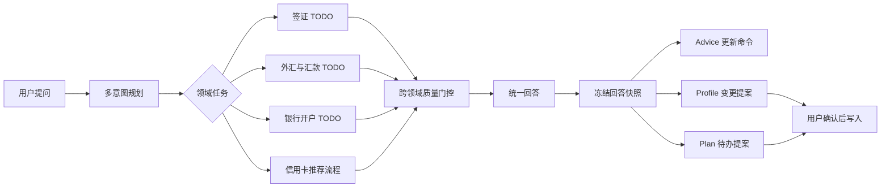

# Agent2 v2 架构

## 目标

Agent2 对用户保持一个入口，同时支持签证、外汇与汇款、银行开户、信用卡四个领域。普通单领域问题走快速路径；一句话包含多个领域时，先拆成独立任务，再统一组织回答。

编排骨架已经完成。签证、外汇与汇款、银行开户、信用卡四个领域的 v2 业务流程先保留为 TODO，处理器会明确返回 `cannot_answer`。

## 框架选择

编排层使用 `pydantic-graph`，业务层只依赖项目自己的 Protocol 和 Pydantic 合约。

- `pydantic-graph` 提供类型化状态机、显式边和可观测的步骤，适合本项目以流程控制为核心的需求。
- 暂不安装完整 `pydantic-ai`。完整包会引入多个模型供应商依赖，并要求 OpenAI Python SDK 3.x；当前项目明确使用 `openai>=2,<3`。
- 暂不采用 LangGraph。它适合更复杂的持久化、多代理图和生态集成，当前四领域受控问答不需要这部分复杂度。
- 暂不采用 OpenAI Agents SDK。其 handoff、guardrail 和 tracing 很合适，但当前版本与项目的 OpenAI SDK 版本约束不兼容。

模型规划器、模型回答器或其他图框架以后都可以作为适配器接入，领域代码和存储代码不需要跟着替换。

## 主流程

## Session 与 Profile

业务 `Session` 指一条独立聊天，不是浏览器登录状态。数据层使用：

- `auth_sessions`：登录 Token；
- `sessions`：Agent2 聊天，一条 Session 绑定且只绑定一个 Profile；
- `sessions.profile_id` 具有唯一约束，因此一个 Profile 也不能绑定第二条 Session；
- Agent2 不提供脱离 Profile 的 general 回答，所有运行都记录 `profile_id` 和 `profile_version`。

Profile 使用三个层次保存：

- `profile_field_definitions`：版本化字段类型、选项、领域、敏感等级和时效规则；
- `profile_field_values`：当前有效画像投影；
- `profile_field_events`：每次设置、确认、清空或过期的追加式历史。

结构化追问选项带 `persist_mode=save_on_select`。用户点击即构成明确确认，消息、Profile
版本、字段投影和字段事件在同一事务提交。自然语言抽取仍生成 `profile_change_proposals`，不会静默覆盖画像。

执行顺序由 `agent2/orchestration/workflow.py` 中的 Pydantic Graph 固定：

1. `plan_tasks`：识别本轮所有领域意图并生成 `TaskPlan`。
2. `run_domains`：通过领域注册表执行任务。目前顺序执行，领域依赖确定后可并行执行互不依赖的任务。
3. `gate_results`：执行跨领域结构和证据门控。任何 `answered` 结果都必须带可审计证据。
4. `compose_answer`：单任务直接透传；多任务按领域合并。
5. `finalize`：先建立不可变 `AnswerSnapshot`，再生成 Advice、Profile 和 Plan 的后续动作。

## 为什么先冻结回答

用户已经看到的回答是一次发生过的事实。快照记录当时的用户问题、Profile 版本、任务计划、知识读取版本、模型版本、门控版本和最终回答。后续 Profile 或知识变化时，系统生成新的 Advice 版本，历史消息不被静默改写，因此可以复现、审计和解释“当时为什么这样回答”。

`AnswerSnapshot` 使用 frozen Pydantic model。存储适配器接入时还必须保证事务顺序：先持久化快照，再应用 Advice 投影；Profile 和 Plan 只持久化候选项，等待用户确认。

## 模块边界

| 模块 | 责任 |
| --- | --- |
| `contracts.py` | 跨模块稳定数据合约、回答快照、后续动作 |
| `ports.py` | Planner、领域流程、Gate、Composer、Lifecycle 接口 |
| `planner.py` | 当前确定性多意图规划器；未来可增加模型规划适配器 |
| `domains/*` | 四个领域流程入口；当前均为显式 TODO |
| `quality.py` | 跨领域质量门控，不替代各领域自己的规则 |
| `composer.py` | 单意图快速路径和多意图统一回答 |
| `lifecycle.py` | 生成 Advice 更新和需要确认的 Profile / Plan 候选项 |
| `workflow.py` | 只负责编排顺序和状态，不承载业务规则 |

## 与现有 Agent2 的迁移关系

现有 `Agent2Runner` 继续承载签证等旧流程。领域按下面步骤逐一迁移：

1. 为一个领域确定输入字段、知识来源、检索、生成和领域门控。
2. 用该实现替换对应 TODO handler，并完成契约测试。
3. 接入回答快照和投影的数据库适配器。
4. 所有领域迁移完成后，把 Service 入口切换到 `Agent2Workflow`。

## 下一步需要确定的领域内容

- 签证：国家与签证类型范围、官方来源等级、材料条件、时效与冲突处理。
- 外汇与汇款：报价时间、费用构成、限额、用途和合规信息的边界。
- 银行开户：资格、身份与地址材料、账户类型、地区和渠道差异。
- 信用卡：产品门槛、奖励、费用、APR、分期成本、免息期、官方来源和核验时间。
