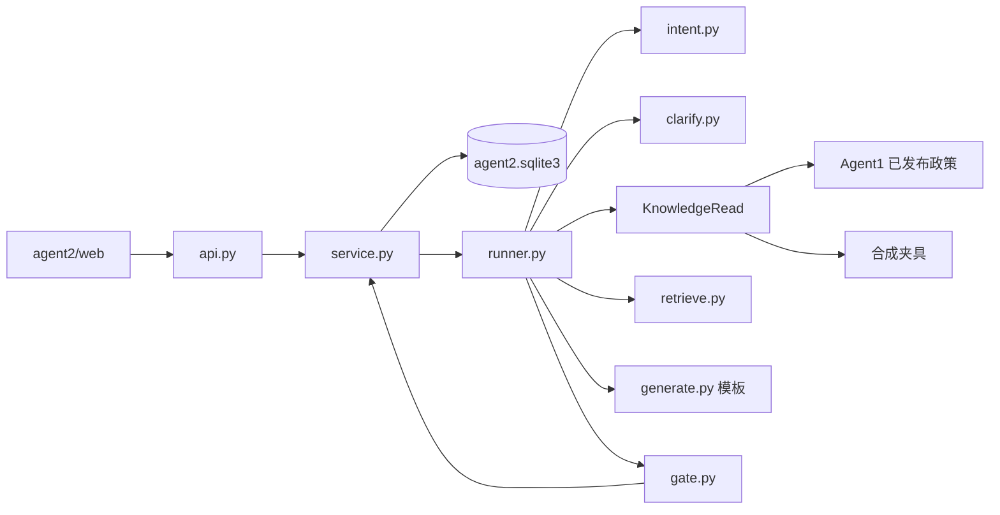

# Agent2 现有框架

日期：2026-10-16。本文描述仓库里已经跑起来的 Agent2，对照代码，不是需求稿。需求到模块的目标设计仍在 `docs/agent2-module-design.md`（文中写明「不是已经实现的功能」）；英国签证切片的实现说明在 `docs/agent2-s1-uk-student-visa.md`；M06 评测口径在 `docs/agent2-m06-metrics.md`。

Agent2 是一个 Python 单体服务：用户问答、档案、建议、待办和审核后台都由 `agent2.py serve` 同进程提供。模块之间是函数调用，没有消息队列，也没有独立向量库。用户数据在本地 SQLite；事实只从 Agent1 已发布政策或合成夹具读入。回答由规则和模板生成，**问答主路径没有接 LLM**。

## 一次问答怎么走



`Agent2Runner.run` 的阶段是固定的，每个阶段单独计时，同一个 `trace_id` 贯穿。未经门控的草稿不会写进结果。

`received → classified → needs_input | knowledge_loaded → retrieved → draft_ready → gated`

1. 消息为空或超过 2000 字，直接 `needs_input`。
2. `intent.classify` 用正则判意图，并抽出目的地、签证类别、资金来源、年龄、学校等本轮说法。说出来的条件只作本轮临时事实，同时生成档案变更提案，不直接改 Profile。
3. `clarify.assess` 按条件表看 `must_have` 是否齐。缺了就追问，最多按规则给问题，状态 `needs_input`。
4. 只有 `visa_documents` 会去读知识。汇款、开户、信用卡能识别意图，但资料未接入，返回 `cannot_answer`。
5. `KnowledgeRead.search` 按国家、签证类别、主题取记录。没有记录是 `cannot_answer`；有记录但都不可用（撤回、过期、超过新鲜度 SLA 等）是 `needs_verification`。
6. `retrieve` 按条件谓词给每条材料标 `required` / `conditional` / `unverified` / `conflict`。适用性不靠相似度。
7. 读完知识后再跑一遍 M06：材料上的条件字段若档案里没有，追问，但不把缺条件的材料写成确定需要。
8. `TemplateGenerator`（`template-v1`）拼摘要、步骤、材料和 claim。
9. `gate.run_gate`（`s1-gate-1`）检查结构、引用是否属于本次证据包、修订是否仍可用、适用性、数字是否出自原文、条件是否写进 claim、来源是否冲突。核心材料全部被挡下则 `cannot_answer`；有冲突则 `needs_verification`。
10. 只有状态是 `answered` 的签证回答会更新当前建议（`advice_current`，主题 `visa`）。

回答状态只有五种：`answered`、`needs_input`、`needs_verification`、`cannot_answer`、`out_of_scope`。范围外包括选校代办、租房合同审查、投资理财。

## 代码落在哪

| 设计模块 | 现在做什么 | 文件 |
|---|---|---|
| M01 身份 | Demo 登录：名字映射到 `user_id`，Bearer token 存在 `sessions`。`AGENT2_DEMO=0` 关闭。没有银行身份。 | `service.py`、`api.py` |
| M02 档案 | 字段白名单、`confirmed`/`unknown`、版本号。PATCH 要带 `expected_profile_version`。 | `service.py`、`clarify.FIELDS` |
| M03 提案 | 对话抽出的字段先成为 `open` 提案，用户确认后才写入档案。 | `service.py` |
| M04 会话 | 会话绑一个 Profile，之后不改。消息正文存在 `message_index.body_json`。`client_message_id` 幂等。 | `service.py`、`store.py` |
| M05 编排 | 显式状态机；意图是规则，不是模型。 | `runner.py`、`intent.py` |
| M06 追问 | 条件表在代码里。可选 `suggest` 钩子，模型建议的字段仍要过表。 | `clarify.py` |
| M07 读知识 | 协议 `KnowledgeRead.search/get`。默认 Agent1 发布面，`--knowledge fixture` 用合成夹具。 | `knowledge.py`、`agent1_read.py` |
| M08 检索 | 结构化条件匹配与冲突，不重排、不向量检索。 | `retrieve.py` |
| M09 生成 | 模板 `template-v1`，不调 LLM。 | `generate.py` |
| M10 门控 | 确定性检查，版本 `s1-gate-1`。 | `gate.py` |
| M11 建议 | 仅签证主题在 `answered` 时写入当前建议和历史。 | `service._persist` |
| M12 计划 | 用户自己的待办，增删改状态。回答不会改计划。 | `service.py` |
| M13 报告 | 没有单独报告表。前端 `#/report/<profile_id>` 用档案、建议和计划拼一页可打印视图。 | `web/app.js` |
| M14 反馈 | 对某条回答提交纠错，列表可查。没有升级到 Agent1 的工单流。 | `service.py` |
| M15 评测 | 只有 `eval-m06`。没有统一指标上报。 | `eval_m06.py` |
| 审核后台 | 设计稿里的用户流程之外。读管理库 `REVIEW_QUEUE`，批准写入 Agent1 正式表。 | `admin.py` |

数据形状在 `agent2/models.py`（Pydantic）：`Profile`、`KnowledgeRecord`、`AnswerResult`、`Citation`、`Claim` 等。

## 知识从哪来

两条实现同一个 `KnowledgeRead`：

- **`Agent1KnowledgeRead`（默认）** 调 `agent1.publication.search/get`，`--agent1-env` 选环境，默认 `development`。`read_id` 形如 `agent1:development`。签证政策的适用条件经 `CONDITION_MAP` 映到 Profile 字段：英国是年龄、资金来源、停留是否满 6 个月、是否住在 TB 名单国家；香港是保证人是院校还是个人、保证人是否永久性居民、常住地、是否持有香港身份证。映不上的条件（例如美国「面签前须缴签证费」）整条材料标成待核实，不当作无条件需要。未发布、已撤回、过期或快照被改过的记录不作确定回答。
- **`FixtureKnowledgeRead`** 读 `agent2/fixtures/knowledge_uk_student_visa.json`。只接受 `synthetic=true`。回答限制里加「【模拟资料】」。`eval-m06` 也用这份夹具。

新鲜度：签证材料主题默认 7 天（`FRESHNESS_SLA`）。超过 SLA 的记录 `availability=stale`，门控不会把它当成确定依据。

覆盖范围：英国、美国、香港的学生签证材料。汇款、汇丰开户、信用卡在意图和条件表里有，前端四类建议里显示「待补充」。

## HTTP

`api.py` 用标准库 `ThreadingHTTPServer`。`/v1/*` 返回 JSON；其他 GET 从 `agent2/web/` 发静态文件。`/admin` 映射到 `admin.html`，其余未知路径回到 `index.html`。静态页带 CSP，脚本只能同源。

用户接口要 `Authorization: Bearer <token>`。管理员接口用另一套 token，互不通用。

| 方法 | 路径 | 作用 |
|---|---|---|
| POST | `/v1/demo/login` | Demo 登录，无需 token |
| GET | `/v1/me` | 当前用户 |
| GET | `/v1/fields` | 字段目录（中文名、输入类型、选项），无需 token |
| POST/GET | `/v1/profiles` | 建档、列出自己的档案 |
| GET/PATCH | `/v1/profiles/{id}` | 读、改字段（带版本） |
| GET | `/v1/profiles/{id}/proposals` | 未决档案变更 |
| POST | `/v1/profile-proposals/{id}/confirm`、`/dismiss` | 确认或放弃提案 |
| POST/GET | `/v1/conversations` | 开会话、列会话 |
| POST | `/v1/profiles/{id}/conversation` | 取或建该档案的会话 |
| GET/POST | `/v1/conversations/{id}/messages` | 历史、发一条（要 `client_message_id`） |
| POST | `/v1/messages/{id}/reaction` | like / dislike，不改档案 |
| POST/GET | `/v1/messages/{id}/feedback`、`/v1/feedback` | 纠错 |
| GET | `/v1/profiles/{id}/advice`、`.../advice/{topic}` | 当前建议 |
| GET/POST/PATCH/DELETE | `/v1/profiles/{id}/plan`、`/v1/plan-items/{id}` | 待办 |
| GET | `/v1/knowledge/snapshots/{revision_id}` | 某次修订的来源与证据 |
| POST | `/v1/admin/login` | 管理员登录 |
| GET | `/v1/admin/reviews`、`.../{id}` | 待审核列表与详情 |
| POST | `/v1/admin/reviews/{id}/approve`、`/reject` | 批准入库或驳回 |

错误体是 `{code, message, retryable, trace_id}`。别人的资源返回 404，不返回内容。

## 用户库

`agent2/store.py` 的 `SCHEMA` 在第一次打开时建在 SQLite。默认路径 `data/agent2/agent2.sqlite3`，`serve --db` 可改。表：

`users`、`sessions`、`profiles`、`profile_fields`、`profile_change_proposals`、`conversations`、`message_index`、`answer_runs`、`answer_citations`、`advice_current`、`advice_history`、`message_reactions`、`feedback_tickets`、`plan_items`。

`answer_runs` 记下当次的档案版本、`knowledge_read_id`、`model_version`、`prompt_version`、`gate_version`、状态和各阶段毫秒。本地把消息正文放在 `body_json`；设计里的 PostgreSQL + OSS 还没接，换存储时要保持同一套读写合同。

管理员账号和 `REVIEW_QUEUE` **不在这张库里**，在 Agent1 环境目录的 `admin.sqlite3`（`ADMIN_USER`、`REVIEW_QUEUE`）。批准走 `formal_pipeline.apply_review`，只写 Agent1 工作表；发布给用户问答仍要 Agent1 的 `publish`。可批准的域表是签证政策、购汇政策、学费，其他域表只能驳回。处理完的队列行删除。管理员 token 只在进程内存，8 小时过期。

## 命令与页面

```bash
.venv/bin/python agent2.py serve --port 8787
.venv/bin/python agent2.py serve --knowledge fixture
.venv/bin/python agent2.py admin add <用户名>
.venv/bin/python agent2.py eval-m06 --repeat 50
```

`serve` 默认监听 `127.0.0.1:8765`，知识源默认 `agent1`。

前端是 `agent2/web/` 的原生 HTML/CSS/JS，没有构建步骤。

- `#/login`：模拟登录（学生/家长，英/港/美预设）。
- 主屏：上方档案与四类建议、待办；下方对话（进度、追问选项、引用、质量状态、有帮助/信息有误/继续补充）。
- `#/onboarding` 建档，`#/report/<profile_id>` 打印报告，`#/feedback` 纠错记录。
- `/admin`：待审核列表、详情（拟写入值与现值、材料、证据）、批准或驳回。

## 和设计稿的差别

已经有的闭环：Demo 身份、档案与提案、会话、签证材料问答（英/美/港）、引用门控、签证建议、待办、纠错、报告页、审核后台、M06 回归。

还没有的：真实身份提供方；汇款/开户/信用卡的已发布知识；M09 的模型生成（LLM key 只给 Agent1 抽取用）；M06 的模型追问默认不启用；向量检索；PostgreSQL 与对象存储；活动提醒；反馈升级到采集侧；管理端的发布/撤回界面。
