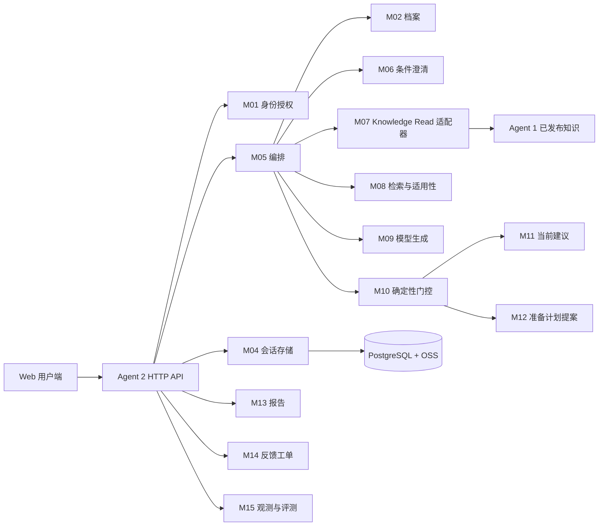

# Agent 2 模块详细设计（需求对齐稿 v0.1）

日期：2026-10-13。依据：[《留学准备助手 产品需求文档 v1.0》](https://docs.google.com/document/d/1FE8GAkXc600MXSVedIw7UUTqDWBRY8Gfcal6ZJGghoQ/edit?usp=sharing)，重点为 U01–U07、A2/A2.1、7.1–7.4、T01–T16；同时参考本仓库《系统设计文档 v0.4》第 5–8 章与 `docs/agent2-technical-design.md`。这是供两人团队评审和分步实现的设计稿，**不是已经实现的功能**。

## 0. 先确定产品语义

1. **Agent 2 是受控问答流程**：用户输入 → 识别服务对象/意图 → 读已确认档案 → 补条件 → 读已发布知识 → 组织回答 → 程序门控 → 保存 → 展示。模型没有直接联网、执行汇款/申请、修改档案或发布知识的权限。
2. **回答有五种状态**：`answered`（已通过检查）、`needs_input`（缺用户条件）、`needs_verification`（来源/适用性/冲突待核实）、`cannot_answer`（无可靠依据或系统失败）、`out_of_scope`（选校代办、租房合同审查、无关投资等）。UI 必须明确显示状态与下一步。
3. **三种用户数据分开**：`Profile` 是用户确认的事实；`Advice` 是四个主题当前的 AI 建议；`Plan` 是用户可编辑的准备待办。点赞回答不改变 Profile；新知识可刷新 Advice，但不能静默覆盖用户的 Plan 状态或自定义事项。
4. **事实只来自 Agent 1 发布面**：Agent 1 目前新数据库仅完成候选生成，正式审核、发布和新只读接口尚未实现。Agent 2 的生产知识接入必须等待该接口。开发测试使用明确标记 `synthetic=true` 的知识夹具，环境隔离。
5. **两人团队的部署边界**：先实现一个 Python 模块化单体服务，模块通过 Python 接口相连；不建微服务、消息队列或独立向量数据库。按系统设计文档，Demo 数据服务目标为 PostgreSQL 与 OSS；本地开发可用适配器，但上线前必须在目标存储上跑通同一套合同测试。

## 1. 需求到模块映射

| 需求 | 主模块 | 必测场景 |
|---|---|---|
| U01 登录 | M01 身份与授权 | T07 |
| U02 档案 | M02 Profile、M03 候选变更 | T01、T03、T06、T07 |
| U03 对话 | M04 会话、M05 编排、M06 澄清、M07 知识读取、M08 检索、M09 生成、M10 门控 | T01–T05、T09、T10、T13、T16 |
| U04 历史/报告 | M04、M13 报告 | T07、T12 |
| U05 活动提醒 P1 | M16 订阅与通知 | T04 |
| U06 准备计划 | M12 计划 | T11、T12 |
| U07 纠错/升级 | M14 反馈工单 | T14 |
| A2.1 证据、多语言、降级 | M07–M10、M14 | T05、T13、T16 |
| 7.2–7.4 安全/性能/质量 | M01、M10、M15 观测评测 | T01–T16 |

## 2. 架构与一次请求



请求状态：`received → authorized → context_loaded → classified → needs_input | knowledge_loaded → draft_ready → gated → persisted → delivered`。失败记录 `error_code`、阶段、`trace_id`，重试只从安全的边界开始。前端可以先显示“正在查询资料”等进度，未经门控的模型草稿不得显示为已核实答案。

### M01 身份与对象授权（U01）

- **输入**：外部身份提供方返回的 subject 或 Demo 模拟身份；请求中的 Profile/Conversation/Report ID。
- **处理**：服务端把 subject 映射到 `user_id`；每次读写检查 `resource.user_id == current_user_id`；管理员角色与用户角色分离。一个 User 可有多个 Profile；每次会话必须绑定一个 Profile，且绑定后不可改。
- **输出**：当前 `user_id` 与授权上下文；失败统一返回 404/403，不泄露他人的资源内容。
- **存储**：`users`、`bank_identity_links`。不存网银密码、短信验证码、完整银行卡号；Demo 登录页显著标注模拟身份。
- **接口**：`GET /v1/me`、`POST /v1/demo/login`（仅 Demo 环境），正式身份回调以银行接口合同为准。
- **验收**：T07；用户 A 不能用猜测 ID 访问用户 B 的 Profile、会话、报告和建议。

### M02 Profile 档案与字段来源（U02）

- **字段**：首次仅角色、服务对象、目的地、学校、offer 状态、预计入学/出发时间；按问题补课程/学年、汇款用途/金额/币种/期限、开户地区/账户状态、签证类别、办卡条件。字段应有 `value`、`status=confirmed|unknown`、`source=user|import`、`confirmed_at`，未知字段用空值和明确状态，不猜测。
- **处理**：用户可查看、编辑、删除字段；每次写入带 `expected_profile_version`，防止会话与界面并发覆盖。家长可建立学生 Profile，但跨账户共享留给 P1 授权功能。
- **接口**：`POST /v1/profiles`、`GET /v1/profiles/{id}`、`PATCH /v1/profiles/{id}`、`DELETE /v1/profiles/{id}/fields/{field}`。删除档案整体及保留策略须在上线前确定。
- **规则**：会话开始时固定读取某一 Profile 版本。档案变化后标记依赖旧字段的建议/计划提案需重算；保留原始回答和当时的 Profile 版本以便追溯。
- **验收**：T01、T03、T06、T07。

### M03 候选档案变更与确认（U03、T06）

- **输入**：用户在对话中说“我的学校改成 X”等，模型只产生 `profile_change_proposal`，包含字段、旧值、新值、原消息 ID、提取依据。
- **处理**：校验字段白名单、类型、用户所有权和当前版本。前端单独展示差异；用户点击“确认更新档案”后才提交。点赞、点击“继续补充”或接受建议均不等于确认。
- **接口**：`GET /v1/profiles/{id}/proposals`、`POST /v1/profile-proposals/{id}/confirm`、`POST .../dismiss`。
- **失败**：确认前 Profile 已变化时返回 `VERSION_CONFLICT`，重新展示新旧值。
- **验收**：T06；未确认提案不会影响后续检索条件。

### M04 会话、消息与上下文（U03/U04）

- **输入**：`conversation_id`、`profile_id`、用户消息、客户端幂等键。
- **处理**：按会话顺序保存用户消息与正式回答；保存完整回答、引用、状态、质量检查结果和模型/提示词/知识版本。上下文只取当前 Profile 的会话；长期事实从 M02 读取，旧回答不得当成政策事实。
- **存储**：PostgreSQL 的 `conversations`、`message_index`、`answer_runs`；完整消息与导出报告在 OSS。写入消息对象成功后再提交索引；孤儿对象定期清理。可将正文放数据库作为本地适配器，但目标环境按系统设计合同使用 OSS。
- **接口**：`POST /v1/conversations`、`GET /v1/conversations`、`GET /v1/conversations/{id}/messages`、`POST /v1/conversations/{id}/messages`。
- **上下文预算**：最近相关轮次 + 可追溯摘要；摘要不得包含未经确认的 Profile 值。超过预算时先删无关闲聊，保留当前问题、确认条件和引用 ID。
- **验收**：历史恢复、重复提交不重复答复、Profile 不串线、断线后能按 `message_id` 拉取最终结果。

### M05 编排与意图分类（A2）

- **意图枚举**：`remittance_tuition`、`remittance_living`、`hsbc_account`、`overseas_spending`、`visa_documents`、`credit_card`、`plan`、`report`、`feedback`、`other`。多个意图可拆成多个主题子任务，但一次回复要标明各主题状态。
- **服务对象**：优先使用当前会话绑定 Profile；用户明确提及另一人时暂停并请其切换或创建 Profile，不能暗中把另一人的事实混入当前档案。
- **工具调用限制**：只暴露 Profile Read、Knowledge Read、消息读取等只读工具；档案写入、计划状态写入、反馈提交走有授权的业务 API。
- **超时/预算**：各阶段单独超时与总超时；模型格式错误仅有限重试；用户可看到当前阶段。重试幂等，不重复写回答或建议。
- **接口**：`Agent2Runner.run(user_id, profile_id, conversation_id, message_id) -> AnswerResult`，内部调用 M06–M10。
- **验收**：同一输入可重放各阶段、错误可定位到阶段，范围外问题走 `out_of_scope`。

### M06 缺失条件判断与追问（T01/T03）

条件表由代码维护，不让模型临时发明必需字段。`must_have` 表示缺失就不能作确定结论；`nice_to_have` 可在回答中注明假设缺口。模型可提出追问建议，服务端按条件表复核并限制每轮问题数量。

| 主题 | 作确定性结论前必须确认的条件举例 | 缺失时动作 |
|---|---|---|
| 学费汇款 | 目的地、学校/收款方、用途、付款期限；算金额还需金额与币种 | 最多追问 1–2 个关键问题；可先给通用准备步骤 |
| 生活费汇款 | 目的地、用途、付款人及渠道相关条件 | 不把学费规则套入生活费 |
| 汇丰开户 | 开户地区、产品/账户类型、申请人身份 | 不跨地区套用门槛 |
| 签证材料 | 目的地、签证类别、申请人条件 | 先问签证类别，不给确定材料清单 |
| 信用卡 | 目标产品范围、申请地区、年龄/身份等已知资格条件 | 仅展示可核实的信息与未知条件 |

每个追问记录 `question_code`、对应字段、触发规则、当前 Profile 版本。用户答复进入 M03 提案或仅作本轮临时条件，界面需说明是否保存。

### M07 Agent 1 Knowledge Read 适配器（A2.1）

- **唯一事实入口**：`KnowledgeRead.search(filters)`；Agent 2 不直接连接 Agent 1 SQLite，也不调用采集任务。适配器返回公开知识领域的统一信封：`record_id`、`revision_id`、`domain`、`scope`、`payload`、`evidence[]`、`source_url`、`source_type`、`verified_at`、`effective_from/to`、`availability`、`schema_version`、`synthetic`。
- **查询过滤**：国家/地区、学校/课程/学年、签证类别、汇款用途、开户地区/产品、卡产品/活动、查询日期。只接受 `ACTIVE` 且未过期、未撤回、来源仍可用、核验时间未超该类别 SLA 的事实进入确定性候选。
- **分类 SLA**：按 PRD 试点值：活动/费率/外汇政策 24 小时；签证/开户材料 7 天；学费/截止日期入学季 7 天、其他 30 天。入学季日历由业务配置，不能在代码中臆定。
- **失败**：服务不可用、字段缺证据、官方来源过期均带结构化原因；不能把过期本地缓存伪装为新核验事实。Demo 适配器只能读取 `synthetic` 夹具，并在 UI 标注。
- **对接前提**：Agent 1 新结构须补齐审核、原子发布、撤回、证据封存与只读接口。当前仓库的新 `scan` 仅生成候选，不可直接给用户使用。

### M08 检索、匹配与冲突检测（T02/T05/T13）

首版按结构化字段过滤，再按标题、关键词、同义词召回；只在候选过多时重排。政策金额/日期/材料的适用性使用确定性谓词，不能由向量相似度决定。中文问题可映射中英主题词，英文证据保留原文。

```text
query → 领域/范围硬过滤 → 当前可用性过滤 → 关键词召回 → 适用性判定 → 冲突分组 → Top-K 证据包
```

每条证据包含：稳定记录与修订 ID、字段路径、原文引用、来源名称与 URL、最近核验时间、适用条件。冲突定义为同一字段/范围/有效期内的不同值或条件；保留全部冲突候选，输出 `conflict`，不任取一个。第三方资料可补充解释，但不能单独支撑高风险结论。维护 `retrieval_version` 与召回日志，供离线评测定位漏检。

### M09 模型生成与结构化输出（A2）

- **输入**：当前问题、最少必要的已确认 Profile 字段、可用证据包、缺失/冲突标记、范围规则。网页及用户原文都当作不可信数据，不允许改变系统规则。
- **输出 Schema**：`answer_status_suggestion`、`summary`、`steps[]`、`materials[]`、`claims[]`、`citation_ids[]`、`unknowns[]`、`follow_up_questions[]`、`advice_proposals[]`、`profile_change_proposals[]`。禁止输出未经检索证据支持的金额、日期、费用、资格和材料要求。
- **职责**：把已验证的结构化事实解释成中文，组织步骤和必要追问；不算金融金额、不作最终适用性判定、不替用户下“批准/保证”结论。英文专有名词、产品名称、金额、币种和日期在 M10 与原文比对。
- **模型治理**：记录供应商、模型、提示词与 Schema 版本、温度/预算、延迟、失败类型；敏感字段最小化。供应商更换先跑完整评测集。

### M10 确定性质量门控与降级（A2.1）

门控顺序固定：输出 Schema → 引用存在且属于本次证据包 → 知识仍可用 → 适用条件 → 数字/币种/日期 → 材料/资格条件 → 来源冲突 → 隐私/越权 → 最终状态。提交回答前复查所引用 revision 是否仍 ACTIVE，避免生成期间撤回。

| 问题 | 门控结果 |
|---|---|
| 缺用户条件 | `needs_input`；保留可安全给出的通用步骤 |
| 有适用数据但非官方、过期或证据不足 | `needs_verification`；说明缺什么、去哪个官方入口核实 |
| 来源冲突 | `needs_verification`；列出差异与来源，不选一个 |
| 关键事实无引用、数字不符或跨地区错配 | 阻断该结论；若为核心结论则 `cannot_answer` |
| 问题在服务范围外 | `out_of_scope`；简短说明边界 |
| 工具/模型故障 | `cannot_answer`；标记可否重试，不能伪装为政策答案 |

金额用 Decimal；日期用 ISO 日期并保留原文时区/生效语义。引用字符串匹配只是必要条件，不能证明条件完整。`answered` 中的每个高风险 claim 都必须有字段级引用（PRD 目标 100%）。高风险、重复纠错或用户要求人工时，M14 提供升级入口。

### M11 四类当前建议 Advice（系统设计 v0.4 第 5/6 章）

固定四类：汇款、开户、签证、信用卡。每类存 `profile_id + topic` 唯一当前版本、生成时间、来源 `message_id`、Profile 版本、知识 revision 列表、结构化条目、状态和未确认条件。每次**通过门控**的相关回答可刷新对应 Advice，同时保留旧版本历史；不相关主题不刷新。信用卡建议显著列筛选条件、比较范围、主要费用与限制、合作/激励披露；到期活动不入建议。

Advice 是 AI 建议展示区，不记录用户是否执行，也不替代 M12 的待办状态。数据变更导致引用失效时标记 `needs_review`，旧建议可见历史但不得继续显示为当前确定建议。

### M12 个性化准备计划 Plan（U06）

- **模型**：`plans`（Profile 与版本）、`plan_items`（事项、适用对象、建议日期、日期依据、依赖、材料、引用、`status`、`origin=generated|custom`、用户编辑标记）、`plan_item_revisions`（变更历史）。状态为 `not_started/in_progress/completed/needs_verification`。
- **生成**：只从已确认 Profile 和有效知识提出计划；没有可靠截止日期就保持 `due_at=null` 并显示“待确认”，不填猜测日期。生成结果先作为提案；用户可审阅、修改、添加自定义事项。
- **变更**：知识更新时为受影响的未完成项生成差异提示。`completed` 或 `custom` 项不自动覆盖；用户确认后才应用对用户编辑内容的修改。系统生成项的来源失效时即刻标记需复核。
- **接口**：`POST /v1/profiles/{id}/plans/generate`、`GET /v1/profiles/{id}/plan`、`PATCH /v1/plan-items/{id}`、`POST /v1/plans/{id}/apply-proposal`。
- **验收**：T11/T12，未知日期不会被伪造；用户完成/自定义内容在来源变化后保留。

### M13 PDF 报告与历史快照（U04）

用户选择要包含的背景字段和当前建议/计划；服务端固定报告快照，包含问题摘要、准备步骤、材料、待办、来源、版本、核验时间、未确认项、生成时间及 Demo 水印（如适用）。报告不把“待核实”改写成确定结论；敏感字段默认不导出。导出异步任务状态 `queued/running/ready/failed`，对象按 User 授权下载。

接口：`POST /v1/profiles/{id}/reports`、`GET /v1/reports/{id}`、`GET /v1/reports/{id}/download`。同一幂等键不重复生成。目标为常规报告试点 P95 ≤60 秒，超时显示状态及重试入口；阈值上线评审确认。

### M14 反馈工单与人工升级（U07）

反馈可指向回答、引用或 Profile 字段；包含 `feedback_id`、问题类型、用户说明、可选证据、严重度、状态、处理人、结论、时间戳、受影响记录。状态 `submitted/in_review/resolved/unconfirmed`。严重资金/签证/开户资格/信用卡费用错误、重复纠错或用户明确要求人工时，生成升级路径；如果尚无在线客服，至少生成反馈编号和可导出的核验清单。用户反馈不得直接改 Agent 1 已发布知识；需交由管理员流程审核。

接口：`POST /v1/feedback`、`GET /v1/feedback/{id}`、管理员受限接口。反馈与来源修订、历史回答和未完成计划项建立关系，以便定位影响面。验收 T14。

### M15 观测、审计与评测（7.3/7.4）

- **追踪**：同一 `trace_id` 贯穿 API、Profile、Knowledge Read、检索、模型、门控、Advice/Plan/报告/反馈；日志不记录网银秘密或不必要 PII，完整消息按授权存储。
- **在线指标**：首状态反馈、完整回答与报告 P95、工具/模型故障率、门控拒绝率、待核实率、费用、反馈率、任务完成率。PRD 试点建议为首状态 ≤3 秒、完整回答 ≤30 秒、报告 ≤60 秒；不是未经测量的上线承诺。
- **离线题集**：按国家/学校/业务、中文问题和英文证据分层，包含 T01–T16 与恶意指令、越权、撤回、时间边界。指标为检索命中、引用正确、答案正确、拒答正确、跨用户隔离；关键虚构、撤回引用、越权泄漏的发布门槛为 0。
- **回归**：每次改提示词、模型、检索、门控或知识 Schema 都跑固定题集，保存版本和差异；人工复核失败样例并补题。

### M16 活动订阅与通知（P1）

用户主动订阅/退订并选择偏好。活动进入推荐或通知前需检查产品适用性、活动有效期、来源新鲜度和用户已知资格；未知资格只提示核实。首选站内消息；邮件/SMS 等渠道待确认。该模块不应成为 P0 阻塞项，但 M11 必须从一开始排除过期活动（T04）。

## 3. 共享数据合同与接口约束

### 3.1 关键表（概念结构）

```text
users(user_id, external_subject, status)
bank_identity_links(link_id, user_id, provider, external_ref)
profiles(profile_id, user_id, version, created_at, updated_at)
profile_fields(profile_id, field_code, value_json, status, source, confirmed_at)
profile_change_proposals(proposal_id, profile_id, field_code, old_value, new_value, source_message_id, status)
conversations(conversation_id, user_id, profile_id, created_at)
message_index(message_id, conversation_id, seq, role, object_key, sha256, status, created_at)
answer_runs(run_id, message_id, profile_version, knowledge_read_id, model_version, prompt_version, gate_version, answer_status, trace_id)
answer_citations(message_id, claim_id, record_id, revision_id, evidence_id, source_url, verified_at)
advice_current(profile_id, topic, version, source_message_id, payload_json, status, updated_at)
advice_history(profile_id, topic, version, payload_json, source_message_id, created_at)
plans(plan_id, profile_id, version, status)
plan_items(item_id, plan_id, origin, title, due_at, due_basis, status, user_edited, citation_refs_json)
plan_item_revisions(revision_id, item_id, before_json, after_json, actor, reason, created_at)
feedback_tickets(feedback_id, user_id, message_id, citation_id, severity, status, assignee, resolution)
reports(report_id, user_id, profile_id, object_key, status, snapshot_refs_json, created_at)
```

所有时间以 UTC 存，UI 按用户时区显示；金额以十进制字符串及 ISO 币种存，绝不使用二进制浮点作资金计算。真实 SQL DDL 在实现阶段根据所用 PostgreSQL 版本单独评审。用户相关记录必须有所有权外键或可追溯连接。`message_id`、`profile_id`、`revision_id` 均为稳定 ID，不因展示重排改变。

### 3.2 最终回答合同

```json
{
  "message_id": "uuid",
  "status": "answered | needs_input | needs_verification | cannot_answer | out_of_scope",
  "profile_id": "uuid",
  "profile_version": 3,
  "answer": {"summary": "...", "steps": [], "materials": [], "limitations": []},
  "claims": [{"claim_id": "c1", "text": "...", "risk": "high", "citation_ids": ["s1"]}],
  "citations": [{"citation_id": "s1", "record_id": "...", "revision_id": "...", "evidence_id": "...", "source_name": "...", "source_url": "...", "quote": "...", "verified_at": "..."}],
  "missing_fields": [],
  "next_actions": [],
  "advice_updates": [],
  "profile_change_proposals": [],
  "trace_id": "uuid"
}
```

API 通用规则：请求带幂等键；修改资源带 `expected_version`；响应和错误含 `trace_id`；错误为 `code/message/retryable`，不含内部堆栈。对话接口可先同步 JSON，流式输出仅用于状态进度；若后续用 SSE，断线后按 `message_id` 拉最终结果。权限由服务端逐对象检查，不能依赖前端隐藏按钮。

## 4. 三条必须跑通的端到端流程

### 4.1 学费汇款（T01）

当前 Profile → 用户问学费汇款 → M05 判定用途 → M06 检查学校、金额、币种、付款期限 → 缺项则追问 → M07/M08 查询相应地区、用途、官方流程与材料 → M09 解释 → M10 核数字/来源 → 保存回答 → 更新汇款 Advice；用户确认 Profile 提案才更新档案。

### 4.2 汇丰某地区开户（T02）

明确开户地区和产品 → 知识查询限定该地区/产品 → 未知资格单独列出 → 引用汇丰官方规则 → 给材料、流程、门槛和限制 → 门控拒绝跨地区规则 → 更新开户 Advice。

### 4.3 签证材料与来源变化（T03/T10/T12）

签证类别未知则先追问；已知后只读当前发布的类别/地区/条件材料。若生成期间 revision 撤回，M10 阻断引用。审核发布新知识后，影响分析标记引用旧 revision 的当前 Advice、报告快照和未完成计划项；报告保留历史快照并标记“生成时依据”，新回答不得引用撤回版本。

## 5. 实施顺序（两人团队）

| 里程碑 | 两人共同能看到的结果 | 必须先完成的验证 |
|---|---|---|
| S0 合同与题集 | `KnowledgeRead` 夹具、Profile/Answer Schema、T01–T16 的样本 | 哪些事实是 synthetic 一目了然 |
| S1 最小问答 | 一个模拟账户、一个 Profile、英国 Student visa 材料主题、带引用的回答；细节见 `docs/agent2-s1-uk-student-visa.md` | 缺条件追问；错误引用被门控阻断 |
| S2 用户闭环 | 历史恢复、候选档案确认、四类 Advice | T06/T07；点赞不改档案、不同 Profile 不串线 |
| S3 计划与报告 | 可编辑计划、PDF 报告、反馈编号 | T11/T14；未知日期不伪造、状态不被覆盖 |
| S4 真实知识 | Agent 1 审核发布/Knowledge Read 接入，撤回影响分析 | T05/T10/T12/T13；待审/过期/撤回不入确定回答 |
| S5 试点准备 | 多主题覆盖、题集评测、安全审查、容量/备份演练 | P0 T01–T16 全通过、阻断性问题为 0 |

一个人主负责 M01–M04、M11–M14 与 Web；另一个人主负责 M05–M10、M15 与 Agent 1 知识适配；每个 PR 由另一人按验收场景复核。此分工只是减少冲突，不是权限边界。每次只实现一个可运行闭环，避免并行堆积未接通模块。

## 6. 与现有方案需要统一的地方

1. 旧 `docs/agent2-technical-design.md` 把四类当前建议写得较完整，但对 U06 可编辑计划、U07 反馈工单和 U04 PDF 报告只作概述；以本文的 M12–M14 作为进一步细化。
2. PRD 的“Agent2 查询数据库”应按系统设计文档解释为**调用 Agent 1 的只读知识接口**，防止 Agent 2 直接读取候选、待审或撤回数据。Agent 1 当前正式新结构尚无该接口，是 S4 的依赖。
3. 需求要求 P0 覆盖汇款、汇丰开户、境外消费、签证和信用卡，但首批国家/学校及信用卡范围仍待确认。S1 只作开发顺序，不改变 P0 交付边界。
4. 系统设计 Demo 的四类 Advice 与 PRD U06 的可编辑计划是不同对象；用户是否完成某个待办，只属于 Plan。
5. 身份接口、MFA、保留期限、部署地域和正式模型供应商尚未确定；使用适配器和配置预留，不假定已获银行接入授权。

## 7. 已确认选择与仍需确认的问题

已确认：S1 第一条端到端流程为**英国学生签证材料**。该选择只决定开发顺序，不缩减 P0 范围。

1. P0 首批国家/学校白名单具体是什么？PRD 暂定英国、香港、美国，但学校/课程范围尚未定。
2. 境外消费在四类 Advice 中归入“信用卡建议”，还是要独立展示一个第五主题？系统设计当前只定义四类。
3. 准备计划是用户主动点击生成后才创建，还是首次问答后自动给出提案？本文暂按“主动生成/用户确认提案”。
4. 反馈工单由谁处理、通过什么渠道回复用户？若首期没有人工客服，需指定核验清单和后台处理负责人。
