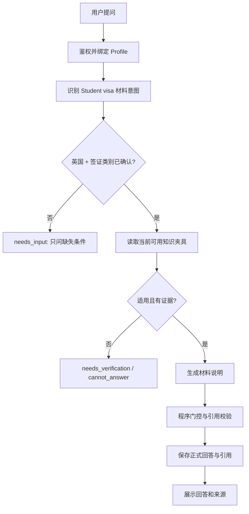

# Agent 2 S1：英国 Student visa 材料问答闭环

状态：实施合同草案，2026-10-13。用户已选择“英国学生签证材料”为第一条端到端流程。S1 是开发顺序中的最小切片，不代表 P0 只支持英国签证。

## 1. S1 做到什么程度

用户用 Demo 模拟身份选择自己的 Profile，问“去英国读书需要准备哪些签证材料”。系统确认目的地和签证类别，缺失时追问；用合成、明确标记的已发布知识夹具返回材料条目和适用条件，逐条附来源引用；对缺证据、未知条件、过期或撤回数据给出待核实状态；保存对话并能恢复。回答不自动更改 Profile。前端明确显示 `synthetic` 演示标记。

S1 不承诺覆盖真实 Student visa 全部材料，也不把仓库里现有的概览页或资金页候选当成已发布的完整签证材料知识。真实接入须等 Agent 1 新结构的审核、发布与只读接口完成。

## 2. 当前 Agent 1 的接点与缺口

- `sources.json` 有 `uk_student_visa` 概览页（`generic_facts`）和 `uk_student_visa_money` 资金页（`visa_policy`），两者都是登记来源。概览页不等于所有子页内容；资金页不等于完整材料清单。
- 正式新结构的 `visa_policy`、`visa_policy_revision`、`document`、`policy_document`、`policy_evidence`、`policy_publication` 已在 DDL 定义。材料条件有 `unconditional/conditional/unknown` 三态；证据可指向具体字段或具体材料要求。
- 当前正式新结构只到 `scan → candidate/review_task`；未实现审核决定、原子发布、证据封存和 Agent 2 只读 API。旧版 `agent1.knowledge.query` 连接 legacy 库，只能作为接口形状参考，不能充当生产事实源。
- 因此 S1 定义 `KnowledgeRead` Python 协议和夹具实现；真实实现日后替换，Agent 2 的编排与门控保持不变。

## 3. 用户路径与问答分支



S1 只把 `country=UK`、`visa_category=student_visa` 作为必需槽位。学校、课程、国籍、年龄、居留史、资金来源等可能改变具体要求，若某个夹具条目的适用条件依赖这些字段，则该条目的结论前必须补齐；不能把所有缺失字段一次问完。比如用户只说“英国签证”，先问签证类别；用户说“英国 Student visa”，可先给有充分证据的通用材料与待确认条件。

## 4. 最小数据合同

### 4.1 Profile（S1）

```json
{
  "profile_id": "uuid",
  "user_id": "uuid",
  "version": 1,
  "fields": {
    "role": {"value": "student", "status": "confirmed"},
    "destination_country": {"value": "UK", "status": "confirmed"},
    "visa_category": {"value": "student_visa", "status": "confirmed"},
    "school": {"value": null, "status": "unknown"},
    "planned_start_date": {"value": null, "status": "unknown"}
  }
}
```

字段来源、确认时间与版本必须存储。S1 的 UI 可以预填 Demo 档案，但预填项须标明模拟且不能伪装为用户确认的真实资料。

### 4.2 Knowledge Read 信封

```json
{
  "record_id": "fixture-visa-1",
  "revision_id": "fixture-revision-1",
  "country": "UK",
  "visa_category": "student_visa",
  "topic": "documents",
  "status": "ACTIVE",
  "synthetic": true,
  "verified_at": "2026-10-13T00:00:00Z",
  "effective_from": null,
  "effective_to": null,
  "source": {"source_id": "fixture-uk-visa", "name": "合成来源示例", "url": "https://example.invalid/fixture", "authority": "synthetic"},
  "requirements": [
    {
      "requirement_key": "fixture-document-a",
      "document_code": "fixture_document_a",
      "required": true,
      "applicability_status": "unconditional",
      "condition": null,
      "evidence_id": "fixture-evidence-a",
      "evidence_quote": "Synthetic example requirement A"
    }
  ]
}
```

以上是合同形状示例，测试时使用注入的基准时钟判断新鲜度，避免固定日期随时间推移导致用例失效。`example.invalid` 不能作为真实引用展示给用户。实际演示夹具应提供本地可展开的合成原文快照，并用醒目的“模拟资料”标签替代“官方”可信外观。知识接口返回 `availability_reason`，可解释过期、撤回、待审核、证据缺失或范围不符。

### 4.3 最终回答

`status` 只能为 `answered/needs_input/needs_verification/cannot_answer/out_of_scope`；每个材料条目附 `requirement_key`、适用条件状态、`citation_id`。引用包含 `record_id/revision_id/evidence_id`、来源、原文片段、核验时间及 `synthetic`。`needs_input` 返回 `missing_fields` 和最多两个有明确字段对应的追问。`needs_verification` 返回原因与官方核验下一步。

## 5. S1 的模块实现边界

| 模块 | S1 最小实现 | 后续扩展 |
|---|---|---|
| M01 身份 | 显著标记的 Demo 模拟用户，后端按 `user_id` 授权 | 汇丰身份接口与 MFA |
| M02/M03 档案 | 建立/读取/编辑 UK Profile；模型提议只展示，不自动写 | 多国家字段与完整确认 UI |
| M04 会话 | 建立会话、按顺序保存/恢复用户消息及正式回答 | OSS 正式接入、摘要与报告 |
| M05 编排 | 一个 Student visa 材料意图的显式状态机 | 多主题拆解 |
| M06 追问 | 国别、签证类别及夹具要求的条件表 | 其他领域条件表 |
| M07 事实读取 | `KnowledgeRead` 接口 + synthetic fixture | Agent 1 发布 API 适配器 |
| M08 检索 | 结构化过滤：国家、签证类别、主题、时间、条件 | 全文/向量召回评测后决定 |
| M09 生成 | 结构化回答；可先模板化，再接模型润色 | 多轮语言优化与模型治理 |
| M10 门控 | 状态、时效、条件、材料证据、引用 ID、来源冲突 | 更复杂的数字/计算门控 |
| M11 Advice | 通过门控后更新 `visa` 当前建议及来源消息 | 其他三类 Advice |
| M15 评测 | 固定案例、阶段日志、`trace_id` | 完整指标面板 |

S1 不依赖 M12 计划、M13 PDF、M14 工单或 M16 活动推送完成；这些仍是后续 P0/P1 的既定范围。代码可以先以一个 Python 服务和一个本地开发前端运行，数据库与对象存储通过接口适配，目标 Demo 再按系统设计接 PostgreSQL/OSS。

## 6. API 与存储最小集

| API | 请求要点 | 成功结果 |
|---|---|
| `POST /v1/demo/login` | 选择 synthetic 用户 | 演示身份；仅 Demo 可用 |
| `POST /v1/profiles` | 最小字段 | `profile_id/version` |
| `PATCH /v1/profiles/{id}` | 字段值、`expected_version` | 新版本 |
| `POST /v1/profile-proposals/{id}/confirm` | 提案 ID、`expected_version` | 经确认的档案新版本 |
| `POST /v1/conversations` | `profile_id` | `conversation_id` |
| `POST /v1/conversations/{id}/messages` | 文本、`client_message_id` | 最终回答与引用 |
| `GET /v1/conversations/{id}/messages` | 分页游标 | 顺序历史与回答状态 |
| `GET /v1/profiles/{id}/advice/visa` | Profile ID | 当前签证建议及来源消息 |

最小表：`users`、`profiles`、`profile_fields`、`conversations`、`message_index`、`answer_runs`、`answer_citations`、`advice_current`。用户/Profile/会话关系通过外键与后端授权双重检查。消息写入幂等；建议更新和正式回答索引同一事务。失败不留下“已经答复”但无正文的记录。数据库/OSS 合同与数据保留规则见模块设计 M04。

## 7. 固定验收案例（先写夹具，再写实现）

| ID | 输入/状态 | 预期 |
|---|---|---|
| S1-01 | “去英国办签证要什么材料”，类别未知 | `needs_input`，只问签证类别，不输出确定清单 |
| S1-02 | 已确认 UK Student visa，合成记录有效且材料有证据 | `answered`，每条关键材料可展开合成原文、修订和核验时间 |
| S1-03 | 一个材料条件为 `unknown` | 不作为无条件必需，提示该条件待核实 |
| S1-04 | 记录 `PENDING_REVIEW`、`WITHDRAWN` 或超过 7 天 SLA | 不作确定事实引用 |
| S1-05 | 两条同范围材料要求相互冲突 | `needs_verification`，展示冲突及来源，不任选 |
| S1-06 | 生成结果引用不存在的 `evidence_id` | 门控阻断该材料；核心回答缺失则 `cannot_answer` |
| S1-07 | 英文合成证据，用户中文提问 | 中文解释保留原文专有名词/数字；引用仍指向原文 |
| S1-08 | 用户 A 请求用户 B 的会话 ID | 403/404，零正文泄漏 |
| S1-09 | 相同 `client_message_id` 重发 | 返回同一结果，不重复消息或 Advice 版本 |
| S1-10 | 用户点赞，或在聊天中说学校变更 | 点赞不写档案；变更仅生成提案，确认后才写 |

这些案例至少覆盖 PRD T03、T05、T06、T07、T10、T13、T16。每条案例保留输入、夹具版本、期望状态、期望引用和关键断言；模型替换时重跑，不能只看 JSON 是否解析成功。

## 8. 两人的第一轮任务拆分

1. **共同（先完成）**：确认 S1 上述状态和 10 个验收案例；将合成资料与真实资料隔离。
2. **开发 A**：Profile/会话/授权/API 与最小页面；让用户能提问、看到状态和展开引用。
3. **开发 B**：Knowledge Read 夹具、签证条件表、状态机、生成与门控；先用模板化输出跑通所有失败分支，再接模型。
4. **交换复核**：A 审查知识条件和门控用例，B 审查越权与档案确认；两人共同演示 S1-01 至 S1-10。

完成定义：从浏览器或 API 创建 Demo Profile，至少完成“追问 → 用户补充 → 有来源回答 → 历史恢复”的真实操作链；10 个固定案例全部通过；界面显著显示合成资料；代码没有连接 Agent 1 候选表或读取未发布记录。
