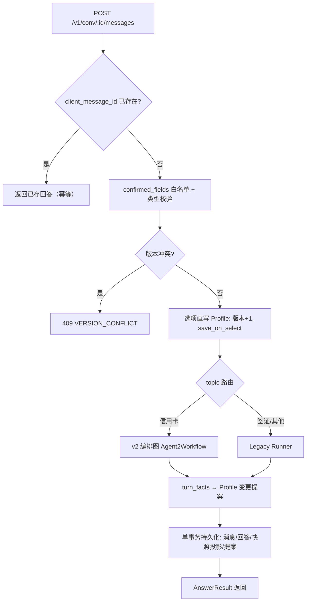

# Agent2 完整指南

Agent2 是 GlobalPathway 的智能问答 agent：对用户保持一个入口，覆盖**签证、外汇与汇款、
银行开户、信用卡**四个领域，为赴港/跨境学生与新人提供有据可查、可审计的金融建议。

相关文档：推荐系统细节见 [credit-card-recommendation-v2.md](credit-card-recommendation-v2.md)；
LLM 边界见 [agent2-llm.md](agent2-llm.md)；架构决策与迁移计划见
[agent2-architecture-v2.md](agent2-architecture-v2.md)；数据库见 [agent1-database.md](agent1-database.md)。

## 模块地图

```text
agent2/
├── api.py            标准库 HTTP API（demo login、对话、档案、提案）
├── web/              极简前端（index.html / app.js / app.css）
├── cli.py            命令行：serve 启动 API、eval-m06 跑评测指标
├── service.py        应用服务层：会话、档案、消息幂等、领域路由、事务持久化
├── runner.py         Legacy Runner：签证等旧流程 + 未接入领域的诚实 cannot_answer
├── clarify.py        Profile 字段注册表（类型/选项/时效/敏感级/领域）+ 追问合约
├── store.py          PostgreSQL/RDS 存储（主 Profile 在 userinformation；审计扩展在 agent2）
├── knowledge.py      知识读取协议 + 合成夹具（M07，签证 7 天新鲜度 SLA）
├── intent.py         确定性意图分类
├── models.py         领域无关的顶层模型（AnswerResult、Profile、提案…）
├── orchestration/    v2 编排层（见下）
├── llm/              LLM 集成层（understanding / writer / provider / 校验）
└── fixtures/         知识夹具 JSON
```

## 一条消息的完整旅程



关键决策：

- **领域路由**（`service.post_message`）：分类出 `credit_card` 走 v2 编排图；签证走
  Legacy Runner；存在未答完的结构化追问时**锁定当前领域**——选项标签（如"境外消费"）
  不会被误分类成新的汇款/签证请求。
- **两种输入模式**：开场自由文本（`free_text`，规则正则 + 可选 LLM 理解抽取事实）；
  追问作答（`structured_selection`，跳过一切抽取，直达 Profile 校验）。
- **幂等与乐观锁**：`client_message_id` 去重；`expected_profile_version` 不匹配返回 409。
- **先冻结后投影**：每轮回答先生成不可变 `AnswerSnapshot`（用户原文、Profile 版本、
  任务计划、知识读取 ID、模型与 prompt 版本、门控版本），再生成 Advice 更新与
  Profile/Plan 候选项；历史回答永不静默改写。

## v2 编排层（`agent2/orchestration/`）

pydantic-graph 类型化状态机，七步固定顺序（`workflow.py`），每步耗时记入 `stage_ms`：

```text
understand_user  自由文本 → LLM 理解端口（可选，失败静默回退规则抽取）
plan_tasks       RuleTaskPlanner 多意图规划（intent → domain 映射，按首现位置排序）
run_domains      依次执行领域流程（依赖明确后可并行）
gate_results     跨领域质量门控：answered 必须带证据，否则降级 needs_verification
compose_answer   单意图直通；多意图按领域拆分合并（每轮仍最多 2 个追问）
write_answer     LLM 改写端口（可选，只动 summary/steps，失败回退模板）
finalize         冻结 AnswerSnapshot → lifecycle 投影（Advice / Profile 提案 / Plan 提案）
```

| 模块 | 职责 |
| --- | --- |
| `contracts.py` | 跨模块稳定合约：`OrchestrationInput/Output`、`DomainResult`、`AnswerSnapshot`、`LifecycleActions` |
| `ports.py` | Planner / DomainWorkflow / QualityGate / Composer / LifecyclePlanner 接口 |
| `planner.py` | 确定性多意图规划；structured_selection 模式按会话意图建任务；LLM 补充意图合并 |
| `domains/` | 四领域入口：`credit_card.py`（已实现）、`visa.py`/`fx.py`/`bank_account.py`（TODO 桩） |
| `quality.py` | answered 无证据 → 降级 + `missing_evidence` 通知 |
| `composer.py` | 单意图快速路径 / 多意图按领域合并 |
| `lifecycle.py` | `PROFILE_FIELDS_BY_DOMAIN` 白名单过滤后生成 Profile 提案（不越域写字段） |
| `legacy_adapter.py` | 让 v2 信用卡领域跑在现有 `Agent2Service` 后面的适配器 |

## 领域实现状态

| 领域 | 状态 | 实现 |
| --- | --- | --- |
| 信用卡 | **已实现（v2 编排）** | RDS 产品库 → 资格路径评估 → 分层奖励估算 → 排序组合 → 借款成本门控，详见推荐系统文档 |
| 签证（英美港学生签证） | **已实现（Legacy Runner）** | 知识库检索 + 材料清单 + 官方入口（GOV.UK 等），材料 7 天新鲜度 SLA |
| 外汇与汇款 | TODO 桩 | 诚实文案："学费汇款流程尚未接入，当前不能生成确定建议" |
| 银行开户 | TODO 桩 | 同上 |

## LLM 集成层（`agent2/llm/`）

只在两个边界使用模型，**推荐决策全部由代码拥有**：

1. `UserUnderstandingPort`（开场自由文本）：抽取意图与显式事实。候选事实必须通过
   字段白名单、置信度 ≥ 0.80、当前消息原文证据子串、字段值校验四道闸。
2. `AnswerWriterPort`（最终表达）：只改写 `summary/steps`；materials/limitations 逐字节
   锁定，出现新数字声明直接拒绝。

Provider 为阿里云百炼 OpenAI 兼容端点（默认 `qwen3.8-flash`，JSON Schema 结构化）。
`factory.build_llm_components()` 按 `AGENT2_LLM_ENABLED=auto`（有密钥才启用）组装；
密钥只放 `local_secrets.py` 或环境变量，不入 Git、不入快照。任何失败回退确定性结果并
追加 `llm_fallback` 通知。Prompt 是 Jinja 模板（`StrictUndefined`），版本记入快照。

## Profile 与 clarify

- **字段注册表**（`clarify.py`）：每个字段声明类型、选项、追问文案、时效（TTL 后过期
  重问）、敏感级（financial/personal）、领域归属。service 层只接受已登记字段——
  未登记的追问字段会在提交时被拒（学生链路曾因此整体不可用，现由
  `CreditCardStudentServiceIntegrationTests` 守护）。
- **三层存储**：`profile_field_definitions`（版本化定义）/ `profile_field_values`（当前
  投影）/ `profile_field_events`（追加式历史）。
- **两种写入路径**：结构化选项 `save_on_select` 点击即确认（同事务提交消息+版本+投影+
  事件）；自然语言抽取只生成 `profile_change_proposals` 等待用户确认，绝不静默覆盖。
- **会话绑定**：一条 Session 唯一绑定一个 Profile（`sessions.profile_id` 唯一约束），
  所有运行记录 `profile_id` 与 `profile_version`。

## 存储

- **用户主数据**：沿用 RDS PostgreSQL 既有 `userinformation` schema；`users`、`profiles`、
  `conversations`、`message_index` 以及四类当前建议 JSON 都以这里为唯一主数据。
- **Agent2 扩展**：独立 `agent2` schema 只保存字段事件/提案、Advice 依赖与历史、刷新任务、
  领域会话状态等既有模型没有的审计数据，并以跨 schema 外键关联主数据。没有 SQLite 回退。
- **产品侧**：同一 RDS 的 `public` schema（`agent1.storage`），推荐链路**只读**（`read_session()`）；
  本地经 SSH 隧道 `scripts/start_team03_pg_tunnel.ps1`（127.0.0.1:15432），生产直连。
  写入只发生在数据同步脚本（`scripts/sync_hsbc_*.py`）。

## 运行方式

```powershell
# 0. Python 环境：.venv（requirements.txt）；本地连 RDS 需先开隧道
scripts\start_team03_pg_tunnel.ps1

# 1. 交互式命令行试用（任意主题对话；--llm 开 LLM 增强）
.venv\Scripts\python.exe scripts\chat.py
.venv\Scripts\python.exe scripts\chat.py --llm

# 2. 自动演示（连真实 RDS，只读）
.venv\Scripts\python.exe scripts\demo_credit_card.py

# 3. HTTP API + 前端
.venv\Scripts\python.exe -m agent2.cli serve --port 8765

# 4. 真实 LLM 追问回放（写 JSON 报告到 data/agent2/eval/）
.venv\Scripts\python.exe scripts\test_agent2_followups.py

# 5. 全套测试（每个集成测试使用隔离的临时 PostgreSQL schema）
.venv\Scripts\python.exe -m unittest discover -s tests -t .
```

## 测试布局

| 位置 | 覆盖 |
| --- | --- |
| `tests/test_credit_card_workflow.py` | 信用卡流程 + service 集成（幂等、版本、续问、学生链路） |
| `tests/test_credit_card_engine_stacking.py` | 引擎验收：分层叠加、推广过期、豁免、双币、披露 |
| `tests/test_agent2_orchestration.py` | 编排图、规划器、门控、组合器 |
| `tests/test_agent2_s1.py` | 签证 S1 流程与未接入领域的诚实文案 |
| `tests/llm/` | LLM 层离线测试（脚本化假模型，零 API 流量）：prompt/provider/ports/校验/factory/工作流路由 |
| `tests/test_credit_card_llm_e2e.py` | LLM 端到端（未配置密钥时自动跳过，不影响 CI） |

## 配置

```text
AGENT2_LLM_ENABLED=auto            # auto=有密钥才启用；0 强制纯规则
AGENT2_LLM_MODEL=qwen3.8-flash
AGENT2_LLM_BASE_URL=https://…/compatible-mode/v1
AGENT2_LLM_STRUCTURED_MODE=json_schema   # deepseek 用 json_object
AGENT2_LLM_EXTRA_BODY={"enable_thinking":false}
AGENT2_LLM_TIMEOUT_SECONDS=60
AGENT2_LLM_API_KEY=                # 实际密钥放 local_secrets.py（已 gitignore）
```

Agent2 状态库使用 `AGENT2_DB_*`；未单独配置时沿用 `AGENT1_DB_*` 连接，但始终写入
`AGENT2_DB_SCHEMA=agent2`，用户主数据 schema 默认为
`AGENT2_USER_SCHEMA=userinformation`。开发环境经 SSH 隧道，生产环境直连 RDS。

## 数据安全红线

1. 产品/政策表对推荐链路只读；用户主数据写入 `userinformation`，审计扩展只写 `agent2`。
2. LLM 密钥与用户数据隔离：理解 prompt 只收当前消息与字段目录，改写 prompt 只收已验证
   推荐对象（不含完整 Profile）。
3. 回答快照不可变，先持久化快照再应用投影，保证"当时为什么这样回答"可复现审计。
4. 门槛判断永不表述为保证获批；最终审批由发卡机构决定。
