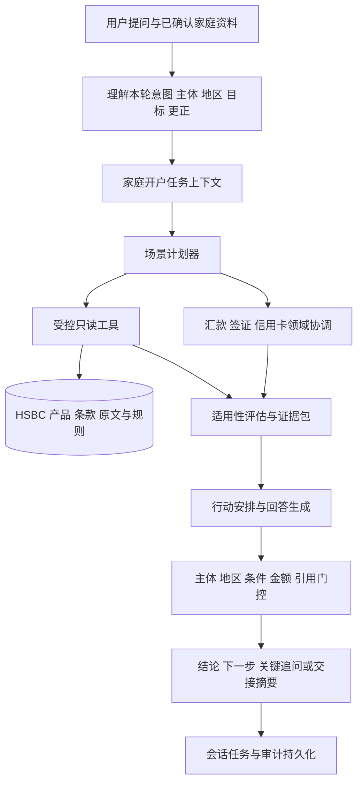

# HSBC 私行家庭留学账户服务：数据审计、架构与验收

日期：2026-11-04。范围：HSBC 香港、英国、美国留学账户咨询。本文为设计与验收提案，不代表功能已实现。

## 1. 结论与本次操作

现有数据库足以支持部分产品查询，不足以独立支撑私行家庭的完整留学账户安排。主要缺口是家庭权益适用、人员与银行关系归属、渠道条件、时间安排、交接与开户后服务，而非产品数量。

本次通过本机已有 SSH key 与本地隧道访问 RDS，先用只读事务检查账户知识表；未读取用户档案、口令或银行客户记录。数据库口令未写入报告、脚本或命令历史。

已执行的数据补充：

- 从 6 个 HSBC 官方页面抓取主要正文，上传 6 份原文归档至已有 OSS bucket 的 `documents/hsbc/`。
- 在现有 `account_source_document` 新增 6 条来源文档，在 `account_doc_chunk` 新增 49 条原文片段。
- 新片段使用中文场景标题辅助现有检索，正文保留官网英文原文。标题是检索标签，不能单独作为资格证据。
- 数据库插入在同一事务内完成；新增文档的声明片段数与实际片段数一致；全库文档片段计数校验无异常。
- 未覆盖原有产品、费用、资格、渠道记录，未变更表结构、应用代码或部署。
- 现有 repository 对三地目录读取成功，并能用中文问题检索到新增家庭权益、英国 Premier 及美国同住址家庭权益片段。这是读取验证，不是端到端问答验收。

补充前账户数据：31 个产品（UK 16、HK 9、US 6）、41 条渠道、70 条资格规则、90 条材料、25 条费用、70 条功能、11 条产品关系、12 份来源文档、51 条片段。补充后来源文档 18 份、片段 100 条，其他数量未变。

## 2. 服务场景与数据覆盖

“部分”指有公开资料支持一部分问题，不代表可以确定个案资格。

| 场景 | 补充后资料支持 | 仍需补齐或核实 |
| --- | --- | --- |
| 家庭留学账户整体安排 | 部分：三地产品、日常用途、海外开户流程 | 多成员账户清单、供款人与开户人区分、个人时间计划 |
| 现有私行关系与子女权益 | 部分：香港 Junior Pack / Next Generation、美国同住址家庭权益、英国本人 International Premier | 私行关系所在实体、子女具体适用条件、年龄边界、费用豁免、跨市场认可，不可自动继承 |
| 出发前预开户与时间规划 | 部分：英国境外申请、美国学生到达前银行服务、香港海外开户协助 | 当前所在地到目的地的可用渠道、收卡和激活细则；约 14 天仅为国际服务页参考，不能作为 SLA |
| 按学费、房租、生活费选账户 | 部分：账户类别、基本支付功能、多币种 | 学校付款方式、本地付款能力、个案需求；不能默认推介储蓄或定期 |
| 未成年子女安排 | 部分：香港儿童/Teens、英国儿童账户条目 | 英国居住与陪同条件、美国未成年替代安排、跨境申请适用；不能把一般银行文章当 HSBC 产品许可 |
| 资格与材料 | 部分：年龄、课程、地址、税务信息、监护材料 | 各渠道的国籍/居住地/所在位置限制、可替代文件与有效期、规则冲突治理 |
| 客户经理与国际银行中心协助 | 部分：官方 RM/IBC 入口和办理路径 | 私行 RM 具体流程、响应时限、预约与工单系统；目前没有真实转介能力 |
| 家长供款与孩子收款 | 部分：官方环球转账与亲子供款说明 | 支持地区、收款对象、限额及费用适用；开户模块不能替代汇款合规判断 |
| 余额、月费与家庭权益 | 部分：三地费用、美国私行资格路径、家庭权益概述 | 正式家庭关联条款与个案适用；无证据不能承诺孩子免月费 |
| 开户受阻、KYC 与补件 | 较弱：一般补件要求、身份和财务信息 | 具体故障流程、资金来源/家庭资助证据清单与银行确认；不能臆测拒绝原因 |
| 落地启用、收卡与紧急支持 | 较弱：一般卡片、数字银行及预开户信息 | 分市场激活/寄卡/手机号/挂失/紧急现金规则和官方入口 |
| 满 18 岁、转学、毕业与回国 | 较弱：香港 Teens 升级、部分英国毕业资料 | 服务资格变化、费用过渡、地址税务信息更新、保留/关闭账户要求 |
| 签证资金证据衔接 | 开户资料本身不足 | 签证模块使用主管机关规则；HSBC 资料仅说明银行文件能力，不认定签证材料是否合格 |
| 账户、借记卡与附属卡组合 | 部分：香港官方附属借记卡介绍 | 卡种、年龄、账户归属、权限和费用条款；借记卡与信用卡不能混用 |

库中无内地账户产品。若服务涉及“家长的中国内地私行关系如何连接境外”，现有三地知识不足，需要另行核实 HSBC 中国的相关公开服务资料；不能因为客户人在内地便假定某条香港路径适用。

## 3. 本次新增官方来源

| 文档 ID | 来源 | 片段数 | 使用边界 |
| --- | --- | --- | --- |
| `hsbc_hk_family_education_audit_20261104` | https://www.hsbc.com.hk/premier/global-banking/ | 8 | 子女家庭服务、香港协助海外开户、附属借记卡、环球转账与地区限制；不推导私行子女自动资格 |
| `hsbc_uk_premier_audit_20261104` | https://www.hsbc.co.uk/current-accounts/products/premier/ | 7 | 英国 Premier 有收入、存款投资、本人国际 Premier 路径；不能声称英国无收入资格路径 |
| `hsbc_uk_predeparture_audit_20261104` | https://www.hsbc.co.uk/international/apply-for-a-uk-account/ | 5 | 可从多个境外地区申请；不是所有国籍、所在地和账户均可 |
| `hsbc_us_family_audit_20261104` | https://www.us.hsbc.com/checking-accounts/products/premier/ | 9 | 最多四名同住址家庭成员的关系权益概述；具体资格和费用须核对正式条款 |
| `hsbc_us_student_predeparture_audit_20261104` | https://www.us.hsbc.com/international-banking/studying-in-the-us/ | 2 | 美国学生抵达前服务及家庭供款概述，不等于任意学生可远程完成全部开户 |
| `hsbc_overseas_process_audit_20261104` | https://internationalservices.hsbc.com/overseas-account-opening/ | 18 | 国际开户流程、材料、参考时长、费用需由 RM/IBC 确认；当地实体条款优先 |

归档：`oss://ai-campaign-oss-team3/documents/hsbc/<文档ID>.md`。原文及片段内容均记录 SHA-256；数据库记录抓取和核验日期。尚未为这些新增片段建立逐条法律条款审核、条件化规则与发布撤回流程。

没有将未经证实的私行家庭豁免、资金来源材料、美国未成年方案或办理时效补成确定事实。公开资料没有覆盖的个案仍应待银行确认。

## 4. 数据与代码之间的关键问题

1. `bank_account_repository.py` 将所有 `existing_customer` 映射为 `existing_hsbc_hk_customer`，英国与美国的本地关系条件会读错市场；必须加入关系持有人和实体归属。
2. 同一读取器不能执行 `one_of`，资金与多路径规则大多转为 `bank_confirmation`。现有表没有明确 AND/OR 分组和费用目的字段；不能靠英文描述是否含 monthly/fee 推断规则语义。
3. 香港 Premier 有重复余额条件，且未将家庭路径/国际路径作为独立、有证据的替代条件建模。新证据不能直接作为解除余额要求的依据。
4. 英国普通账户、国际学生等存在重复渠道；部分结构化记录只写英国当地申请，与境外申请原文信息不完整一致。这是渠道建模和证据对齐问题，需逐条校正，不能删除所有当地渠道。
5. 美国部分材料写成一概需要“美国居住地址”，而当前官网写的是 permanent address；应按具体申请渠道核实，不能覆盖成“任何境外地址都行”。
6. `bank_account.py` 的英国 Premier 收入纠正文案声称已收录账户无年收入门槛，与库内及官网的英国 Premier 收入路径不符。香港和美国口径不能复制到英国。
7. `product_order` 是加权排序，不是资格过滤；它仍可能展示不满足条件的候选。之前对其“已排除不适用产品”的描述不准确。
8. `product_order` 使用 `existing_hsbc_customer`，其他位置使用更窄的香港字段；是否另有上游写入须继续核查，不能断言此分支永远不生效。
9. `AccountConversationState` 按市场分支，但未按孩子/开户人隔离。多名子女同一市场时可能复用错误焦点和条件。
10. 缺地区时可能默认香港；私行家庭跨境问题应先明确必要地区，不能把客户关系所在地、提交所在地、留学地和账户市场混为一谈。
11. 发现、比较等确定性分支不读取来源片段；补数据不会自动改善这些分支。现有检索为字面词匹配，新片段中文标题仅改善部分可检索性。
12. 原文参与 writer，但最终 `evidence()` 以 assessments 生成引用。需要建立片段级 claim 到引用的绑定，避免新增事实没有对应证据。
13. 读取账户产品主要过滤 ACTIVE，未充分执行 data_status、生效失效日期、核验时效、冲突门控。verified 标签本身不证明每条描述适用。

旧静态 `hsbc_account_knowledge.py` 不是当前 `BankAccountWorkflow` 的主知识源；主源为 RDS repository。此前把静态目录当运行时主知识库不准确。

## 5. 建议架构

保持现有单体、顶级编排与领域工作流，增加家庭任务建模及可审计工具，无需拆成多个独立自治 agent。

### 5.1 家庭上下文

- 人员：提问者、开户人、关系持有人、供款人、监护人分别用 person_id 标识；支持多个孩子。
- 银行关系：holder_person_id、bank_entity、market、segment、既有产品、关联成员、确认状态、证据与时间。私行服务身份与银行已验证关系分开。
- 留学安排：目的地、出发日、开户需求日期、课程与阶段。
- 申请任务：以 applicant_person_id + account_market + task_id 为作用域，记录申请所在地、居住地、国籍/证件、渠道偏好、阶段、焦点/选定/排除产品。
- 事实：区分用户本轮陈述、已确认档案、银行验证、未知、明确没有和过期待核实。用户说“我是私行客户”可用于提供相关服务说明，不能等同银行身份核验。
- 会话焦点和临时设想不自动写入长期档案。成年子女账户的访问权不因家长是客户而自动授予。

### 5.2 场景计划器

识别“当前需要完成的服务任务”和问句主题。可组合家庭权益、预开户、未成年人、材料、费用、启用等任务；使用现有 dialogue_act 保持连续追问与更正。

默认执行一次计划、最多 4 个独立只读工具、一次有界补查，总工具调用不超过 6 次。相互独立查询并行；依赖资料的步骤顺序执行。超时后先给有证据的部分结论并说明待核实项。

不预设必须推荐 Premier；先判断现有账户是否够用，再评估普通账户与合资格家庭方案。一个有依据的主方案加一个必要替代方案通常足够，不主动展示完整目录。

### 5.3 工具契约

| 工具 | 结构化返回 |
| --- | --- |
| `get_family_entitlements` | 关系持有人、受益人、原/目标市场、年龄/地址等条件、已确认/不适用/未知、正式条款与转介入口 |
| `find_opening_routes` | 产品与渠道分开，出发前可完成阶段、到场/激活/收卡条件、适用所在地和材料 |
| `evaluate_eligibility` | 产品、渠道、服务权益分别评估；支持 AND/OR、数值边界、日期及未知逻辑 |
| `get_document_checklist` | 必需、条件触发、可替代、可能补件；材料属于谁、哪条渠道、有效期和依据 |
| `evaluate_fees` | 开户服务费、最低入金、持续关系余额、管理费、豁免路径及生效日期分别返回 |
| `get_account_operations` | 启用、收卡、联系方式变更、故障与紧急服务的分市场官方流程 |
| `build_opening_plan` | 步骤、责任人、依赖、客户目标日期、官方参考时长与未知项；不编造银行 SLA |
| `prepare_handoff` | 已知事实、客户目标、已核实路径、未决问题、建议材料、官方入口；无发送集成时仅生成摘要 |

每个工具输出 evidence_id、原文片段、来源、产品/市场/人员适用范围、核验与有效日期、确定性状态。工具不能返回无依据的“肯定获批”。

### 5.4 知识层

保留现有产品、渠道、材料、费用、功能和产品关系表。后续补充逻辑实体：家庭服务权益、服务渠道与操作流程、规则组、证据版本、规则到片段的映射；本次未创建这些表。

规则包含 subject_role、relationship_owner、origin/destination_market、purpose、AND/OR group、predicate、required、effective dates、evidence、review status。家庭权益不能硬塞成孩子的资产事实，也不应为每种服务虚构一个账户产品。

来源优先级：目的地正式条款/费用表和明确渠道规则，优先于产品页概述；国际宣传页提供入口与概述，不覆盖当地条件。冲突没有解决时返回待核实，不简单采用更新日期较新的页面。

以结构化场景、实体及市场筛选证据，再进行中英混合检索与重排。每个要输出的事实必须引用本轮实际读取的片段。家庭权益、费率和渠道清单设核验频率，过期或撤回时停止给出确定结论。

### 5.5 用户输出与交接

简短问答先回答当前问题；复杂筹备任务可展示账户安排卡、出发前/落地后清单。输出包含：当前结论、适用条件、下一步责任人、最多一个会改变当前路径的追问、可展开来源。

“联系客户经理”应附待确认问题及已知信息，避免客户重新叙述。只有真实工单接口返回 receipt 后才能说“已转介/已预约”。具体私行豁免、特殊审批、未成年人跨境例外等可以要求银行确认，但不能所有问题都推给客户经理。

## 6. 验收标准

以下为未来实现的发布门槛，尚未执行或通过。

### 6.1 测试集与评审

至少 100 个用例，其中至少 40 个为 4—8 轮连续会话。香港、英国、美国各不少于 25 个，其余覆盖跨市场；12 个主场景各不少于 5 个，可交叉计数。加入多个孩子、未成年边界、条件更正、中英混合、来源冲突、资料过期、模型/数据库/工具失败。

固定知识快照作为期望答案依据；每条用例标注主体、市场、任务、必要结论、禁止结论、必要追问、行动和证据。由产品评审及熟悉当地业务的银行人员独立复核，模型自评分不能替代人工验收。

### 6.2 必过场景

| 输入或会话 | 必须满足 |
| --- | --- |
| 香港私行家长，19 岁孩子赴英国，问是否需另放资金 | 区分家长关系与孩子资格；查家庭及跨境路径，不承诺自动豁免，不先要求精确资产金额 |
| 同一家庭 17 岁与 21 岁孩子去同一市场 | 两个任务独立；年龄、材料和账户焦点不得串用 |
| 英国 Premier 有没有收入要求 | 准确解释收入是资格路径之一，与存款投资及本人 International Premier 路径并列 |
| 家长在香港有 Premier，孩子赴美国住学校宿舍 | 不自动认定满足美国 same residential address 条件；说明需核对适用条款 |
| 英国境外预开户，尚无英国地址 | 查境外渠道及可接受材料，不把英国地址写成所有渠道共同必需，也不承诺任意海外地址均可 |
| 美国没有 SSN 能不能开 | 区分渠道和税务信息要求；没有充分证据时不给绝对能/不能，不把护照当税务证明 |
| 美国“孩子17岁能开吗” | 不推荐 18+ 个人账户为确定可办；不把通用文章的未成年联名可能性当 HSBC 产品许可 |
| 香港 Teens 无永久居民身份证 | 核对该产品证件要求，不能因家长是私行而跳过；只给有证据的替代路径 |
| 两周后出发，要求出发前拿卡 | 区分申请/审核/开户/收卡/激活；参考时长不变为承诺 |
| “这个月费呢”→“那就这个”→“年龄说错了” | 保持正确焦点，费用追问不重推目录；明确选择才设置 selected，更正后重新评估 |
| 开户后家长汇生活费 | 向汇款模块传递正确供款人、收款人和市场；不混淆同名与第三方汇款 |
| 家长问能否查看成年孩子每笔消费 | 不因家庭关系自动授予访问权限；核对授权及产品机制 |
| 银行要求资金来源资料 | 不猜测拒绝原因、不保证材料被接受；给已证实要求和交接问题 |
| 问签证资金证明 | 签证规则由对应领域判断，不声称开立境外账户就是签证必要条件 |
| “帮我转给客户经理” | 没有真实发送接口时明确提供交接摘要，不声称已经发送 |
| 证据不足或冲突 | 仍给可确认的部分答案，列出具体待核实问题；不输出无条件结论 |

### 6.3 量化发布门槛

- 主体、市场、家庭权益继承、资格、金额/币种/周期、权限、虚假审批/转介等严重错误：0；任意一例阻止发布。
- 所有可核实关键结论有匹配证据：100%；关键事实必须保留会改变结论的条件，不能只通过数字校验。
- 固定必过场景：100%；全部用例任务完成率至少 90%，每个市场及主场景至少 85%。
- 多轮焦点、主体与条件更正准确率至少 95%；多孩子信息串用为严重错误，不受平均分豁免。
- 缺失关键事实且会改变当前路径时才追问，每轮最多一个；已知事实重复追问率不超过 5%。
- 故障用例 100% 不制造资格、费用、办理成功或已转介；能返回已核实部分结论或明确暂不可答。
- 正常环境不含故意注入的故障，确定性查询 P95 不超过 5 秒，需模型综合的完整回答 P95 不超过 20 秒；超过 3 秒提供处理状态。测量需记录网络及模型配置。
- 每次回答可追溯到知识版本、工具输入/结果、事实来源、规则计算、最终引用及回退原因。

### 6.4 私行客户体验验收

至少 10 位目标客户或明确按私行家长画像参与的独立评审，每人完成两个完整任务，合计至少 20 次任务评审。隐藏版本，按 1—5 分评价：是否理解我的家庭安排、是否正确使用现有关系、是否减少准备工作、费用条件是否清楚、下一步是否可执行。

至少 80% 的任务在所有上述维度达到 4 分及以上；至少 80% 的评审愿意继续用它准备开户或将摘要交给客户经理。严重错误仍为零，不能用满意度抵消。

具体产品交付物应让客户确认“谁开户、开在哪里、走哪条渠道、什么时候做什么、谁负责、哪些条件已确认、哪些问题需银行确认”。能查出产品名称但不能提供这些安排，不算复杂任务完成。

## 7. 客户视角判断与实施顺序

以私行家长角色审视，当前版本可作有来源的资料查询助手，尚不足以让我放心依赖它安排孩子的境外账户。它有产品信息，但家庭权益与关系归属不足，且存在市场条件映射和英国收入表述问题。本次证据补充不改变这一判断。

达到本设计验收后，可以接受其作为私行留学开户咨询与准备助手，协助制定安排和减少与客户经理来回沟通；实际审批、关系验证、账户权限和预约以真实银行流程为准。这是基于证据的产品评估，不是已完成真实客户试用的结论。

建议顺序：先治理规则/渠道冲突及市场主体映射，再做家庭任务与权益核验，然后接入时间计划、材料、费用和交接摘要，最后扩展落地运营、故障及毕业场景。每阶段使用同一批多轮验收用例回归，不能只以新增意图数量或补充产品数量作为完成标准。
